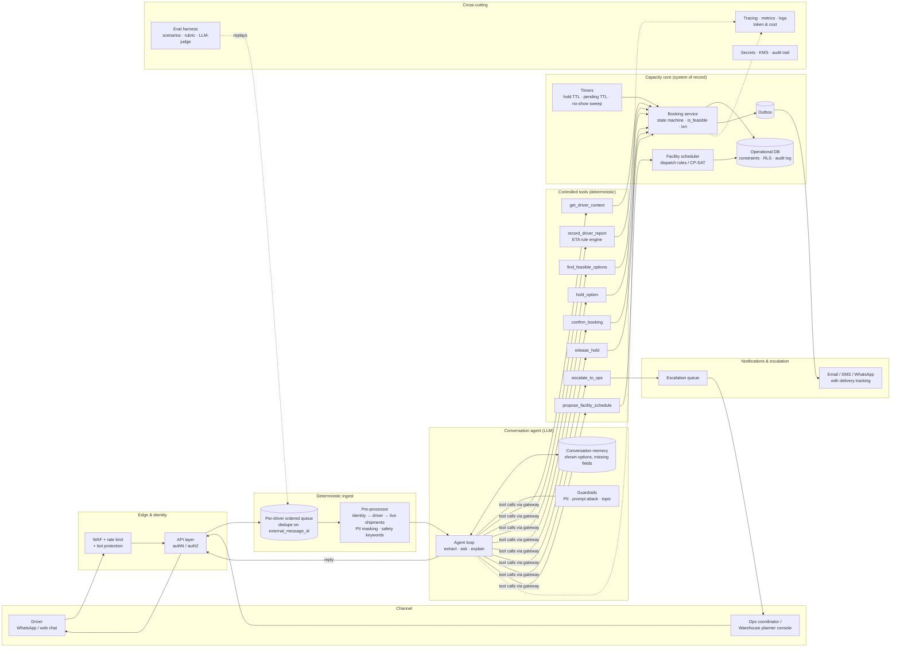
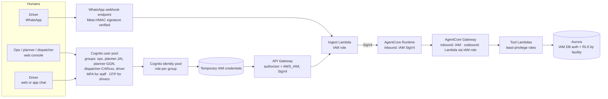
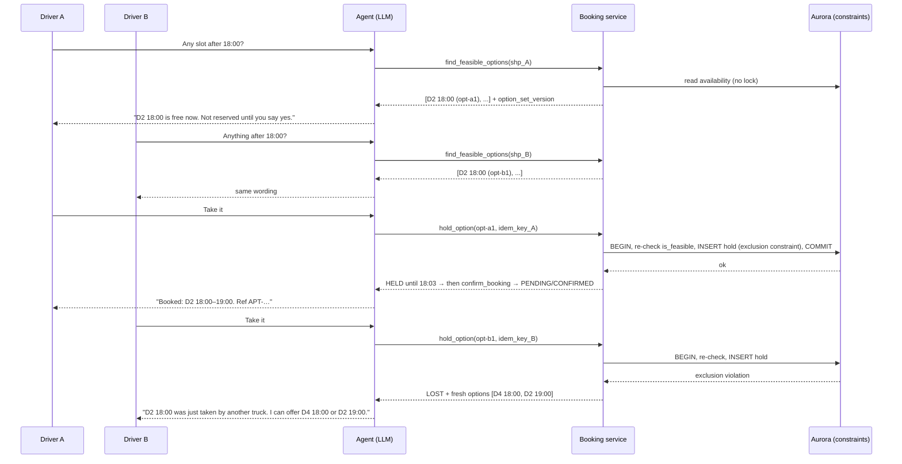

# Phase 1 · Frame — High-Level Design

> **Historical Frame-phase design (Phase 1, November 2026). This is not the as-built system.** It is kept unchanged as the record of the first design. In particular, the IAM (SigV4) authorisation for every API call, the driver sign-in by phone OTP and the AgentCore platform shown here were not built. For what exists, read the root [`README.md`](../../README.md#live-synthetic-pilot), assumptions S1a–S1c in [`01_problem_definition_sheet.md`](01_problem_definition_sheet.md) and the as-built [`Technical Appendix`](../../artifacts/fde-demo/SetuHaul_FDE_Technical_Appendix.md).

This is the shape of the system and where each responsibility sits. Phase 2 (Design) turns it into the full architecture, decision register, service-by-service specification and cost model.

---

## 1. Design principles

1. **Workflow first, agent at the edges.** Fixed code paths handle anything with a right answer: identity, ETA rules, feasibility, holds, commits, no-show and escalation routing. The LLM handles only the edges: reading messy text, asking the next question and explaining results in plain words. This follows the brief and Anthropic's *Building effective agents*.
2. **The database decides capacity.** A promise exists only when a transaction commits under constraints. The LLM cannot write capacity state. It can only call tools, and those tools re-validate everything.
3. **Every write is idempotent and re-checked.** Messages are deduplicated at ingest. Every write tool takes an idempotency key. Feasibility is checked again at commit.
4. **Fail toward a human with a complete record.** If no safe automatic outcome exists, escalate. Never invent a slot.
5. **Replayable.** Use an injected clock, versioned prompts, policy and config, and keep the full trace. Every decision can be replayed and evaluated.

## 2. Logical architecture

## 3. Where the LLM is used and where it is not

| Step in handling one message | Who | Why |
|---|---|---|
| Authenticate sender, map phone → driver | Code | A fact. Must not be guessed |
| Deduplicate and order messages | Code (queue + idempotency) | Retries are an infrastructure fact |
| Mask PII before the model sees it | Code + guardrail | Compliance |
| Safety keyword pre-check (accident, injury, fire) | Code (and LLM flag) | Either one triggers a human. Safety is not the agent's decision |
| Understand intent and extract ETA / constraints from free text | **LLM** (structured output) | The only place free text is interpreted |
| Validate extracted values (ranges, enums, which shipment) | Code | Rejects impossible values and drives clarification |
| Decide what is missing and therefore what to ask | Code computes `missing_fields`; **LLM** phrases the question | Asks only for facts the backend does not hold |
| Compute effective ETA and confidence | Code (ETA rule engine) | Decision 3 |
| Feasibility, options, ranking | Code (`is_feasible`, ranker) | Capacity is a structured decision |
| Hold, commit, confirm, release | Code (transaction + constraints) | Integrity |
| Ordering simultaneous requests, priority | Code (policy plus scheduler) | Business policy, not model judgement |
| Re-sequencing a facility after events | Code (scheduler tool) | Optimisation over structured state |
| Explain options, refusals, changes in plain words | **LLM**, given only tool output | Tone and clarity. A post-check verifies that every time and dock it states appears in tool output |
| Escalation routing and hand-off record | Code builds the record; **LLM** writes a 2-line summary | Completeness is guaranteed by schema |
| Hold expiry, pending expiry, no-show marking | Code (timers) | Time-based. No conversation needed |

**ML beyond the LLM:** none is needed in v1. Capacity, priority and ETA are rule- and optimisation-based. Candidate later additions, which need more data than the snapshot holds, are an ETA-slip predictor from historical `eta_updates` vs actual gate-in, and unload-duration prediction per load type. Both would only feed `eta_confidence` and `occupancy_min`. They would never decide alone.

## 4. Mapping the reference sketch (JPEG) to this design

The sketch shows *customer → front-end → backend → API → tools*, with six protection concerns. Each maps as follows, with the AWS-native choice first and the sketch's tool as an alternative.

| # | Concern in sketch | Our design (AWS) | Sketch alternative | Note |
|---|---|---|---|---|
| — | Front-end / backend / API | Channel webhook + ops console → **Amazon API Gateway** → ingest Lambda → **Bedrock AgentCore Runtime** (agent) | — | Drivers use WhatsApp, not a website. The console is a small web app |
| — | Tools | **AgentCore Gateway** exposes Lambda tools as MCP tools with schemas | — | Every tool is deterministic code |
| — | API gateway, rate limiting, "token maxing" | API Gateway throttling and usage plans; per-driver rate limit at ingest; **per-conversation token and turn budget** enforced in the agent loop; Bedrock quotas | — | Token budget = cost and abuse guard |
| 1 | User authentication | **Amazon Cognito** user pools for every human user: ops coordinators, warehouse planners, carrier dispatchers, and drivers on the web or app channel (passwordless SMS / WhatsApp OTP). MFA for ops and planners. WhatsApp drivers are matched by their verified sender number to the Cognito driver record | — | See §4a |
| 2 | API authorisation ("IAM") | **IAM everywhere for APIs.** Cognito identity pool exchanges the user token for temporary IAM credentials, with a role per group. Every API Gateway route uses `AWS_IAM` (SigV4). Services use IAM roles. AgentCore Runtime and Gateway are invoked with IAM. Aurora uses IAM DB auth. No long-lived IAM user keys | IAM user | Improved: roles, not users. See §4a |
| 3 | Cloudflare / API protection | **AWS WAF** on API Gateway / CloudFront (managed rules, bot control, rate rules) and AWS Shield Standard | Cloudflare | Either works. WAF keeps it in one account and one set of logs |
| 4 | PII protection (Presidio) | **Bedrock Guardrails** sensitive-information filters (mask phone, licence, names) plus a deterministic pre-mask for known identifiers. Logs are redacted | Presidio (can run as a Lambda layer) | Driver phone and licence are PII |
| 5 | Model routing (LiteLLM) | **Deterministic route by task in code**: a small, fast model for extraction and classification, a stronger model for multi-turn replies. Optional Bedrock prompt routing | LiteLLM | Routing by task is predictable and testable |
| 6 | Database protection (RLS; Supabase / Neon) | **Amazon Aurora PostgreSQL** (Serverless v2): RLS by facility for console users; `EXCLUDE USING gist` for dock-time overlap; private subnets; IAM auth; KMS; tools use only stored procedures or the booking service | Supabase / Neon (Postgres + RLS) | Postgres exclusion constraints close gaps 1–4 of the audit |

## 4a. Authentication and authorisation: Cognito for users, IAM for APIs

| Caller | Authenticates with | Authorised by | Notes |
|---|---|---|---|
| Ops coordinator, warehouse planner, carrier dispatcher | Cognito user pool (password + MFA, or corporate SAML/OIDC federation) | IAM role from the identity pool, per group. Group decides the API routes. Facility scope is enforced again with Aurora RLS using the user's `facility_scope` claim | Planner-JAI cannot see GGN rows |
| Driver on the web or app channel | Cognito passwordless OTP on the phone in `drivers.phone` | IAM role `driver`, which may only call `/chat` for itself. The driver id comes from the token, never from the message | |
| Driver on WhatsApp | Meta-verified sender number. The endpoint verifies Meta's `X-Hub-Signature-256` HMAC (Meta cannot sign SigV4) | The ingest Lambda maps the number to a Cognito / `drivers` identity, then calls everything downstream with IAM | **The only non-IAM entry point.** It has no other routes, sits behind WAF and is rate-limited |
| Internal services (ingest, timers, scheduler, notifier) | IAM roles | IAM policies per function (least privilege) | |
| Agent → tools | AgentCore Runtime execution role → AgentCore Gateway (IAM) → Lambda | IAM, plus in-tool checks that the shipment belongs to the calling driver's thread | Policy in AgentCore can add declarative tool-call rules |
| Partners (telematics, FASTag aggregator callbacks) | IAM Roles Anywhere or cross-account roles where the partner can sign. Otherwise a separate HMAC endpoint like WhatsApp | IAM | |
| Booking service → Aurora | IAM DB authentication via RDS Proxy | DB roles plus RLS | No static DB passwords |

## 5. What needs to be added beyond the sketch

The sketch covers the perimeter. The brief's hard parts are inside it, so the design adds the following:

| Addition | Why (evidence) | Candidate AWS service |
|---|---|---|
| **Ingest idempotency and per-driver ordering** | Duplicate retry THR001 / THR009 (A18, A19) | SQS FIFO (`MessageGroupId = driver_id`, dedup id = `external_message_id`) plus an idempotency table |
| **Hold / commit state machine with TTLs** | Two drivers, one slot. Pending confirmations with no expiry (A23) | Booking service on Aurora. EventBridge Scheduler or Step Functions for TTLs |
| **Integrity constraints beyond the two indexes** | A03, A04, A08, A12 | Postgres exclusion and check constraints |
| **Transactional outbox for notifications** | A failed email was treated as sent (A21) | Outbox table → EventBridge → SES / SNS / End User Messaging, with delivery-status tracking |
| **Escalation queue and ops console** | Five coordinators. Need complete hand-offs | SQS / DynamoDB queue plus a small console (Amplify / S3 + CloudFront), Cognito |
| **Facility scheduler tool** | Optional extension | Lambda (Python; OR-Tools only if justified) |
| **Conversation memory** | Multi-turn context, shown options | AgentCore Memory (short-term events; long-term driver preferences only if useful) |
| **Observability for agents** | Measures in the brief. Cost visibility | AgentCore Observability → CloudWatch (GenAI observability), X-Ray / OpenTelemetry traces, custom metrics per measure |
| **Evaluation harness and rubric** | "Multi-turn evaluation of agent behaviour". The scoring rubric | Scripted scenario replays in CI; deterministic assertions (no double booking, required fields); LLM-as-judge with a rubric for reply quality; AgentCore Evaluations where available |
| **Guardrails on output** | Agent must not overpromise | Bedrock Guardrails (contextual grounding) plus a deterministic post-check that every time and dock in the reply exists in tool output |
| **Policy enforcement on tool calls** | "Agent never decides alone" list | Tool-level authorisation (only the owner's shipment) and AgentCore Policy / Gateway interceptors where available; otherwise in-tool checks |
| **Injected clock and replay** | No single as-of time (A13) | Clock parameter in every tool. Replay runner |
| **Audit trail** | Disputes and penalties need evidence | Append-only `booking_events` table plus CloudTrail |
| **Secrets and keys** | WhatsApp token, DB creds | Secrets Manager, KMS |
| **Independent ETA signals** | Driver messages are unverifiable (see `04_eta_signals_and_tracking.md`) | FASTag via ULIP, WhatsApp location pins, targeted SIM tracking, existing telematics. EventBridge Scheduler pollers. Deterministic `fuse_eta()` |
| **Data residency** | Indian operations, driver PII | Everything stateful in ap-south-1 (Mumbai). **Verified:** Claude in Mumbai is served only through Bedrock's *Global* endpoint, so prompts may be processed outside India. Consequence: PII and coordinates are masked **before** any model call. Client sign-off needed (§7a) |
| **Cost guardrails** | Burst spikes | Per-conversation turn and token caps, prompt caching, AWS Budgets alarms |
| **Disaster recovery** | System of record | Aurora backups / PITR. Multi-AZ |

## 6. Critical flow: two drivers, one slot

The promise is made **only** after the commit succeeds. The losing driver hears the truth and gets fresh options in the same turn. A retried "Take it" with the same idempotency key returns the original result and never creates a second booking.

## 7. AWS service shortlist (finalised in Design)

| Layer | Service |
|---|---|
| Agent hosting | Amazon Bedrock **AgentCore Runtime** (agent built with Strands Agents or LangGraph; framework chosen in Design) |
| Models | Amazon Bedrock (Claude in Amazon Bedrock, `bedrock-mantle` Messages API): `anthropic.claude-haiku-5-5` for extraction and classification, `anthropic.claude-sonnet-5-5` for the conversation. Both are listed for Bedrock and both are on the Global endpoint (verified, §7a). Model access must be requested per model in the Bedrock console |
| Tools | **AgentCore Gateway** → AWS Lambda (Python) |
| Memory | **AgentCore Memory** |
| Identity | **AgentCore Identity**, Amazon Cognito, IAM roles |
| Guardrails | **Amazon Bedrock Guardrails** |
| Observability | **AgentCore Observability**, Amazon CloudWatch, AWS X-Ray / ADOT |
| Evaluation | AgentCore Evaluations (available in Mumbai, verified) plus our replay harness in CI (CodeBuild / GitHub Actions) |
| Users and API authorisation | Amazon Cognito (user pool and identity pool) for every human. IAM (SigV4) on every API (§4a) |
| Scheduler | Python Lambda (container image) running OR-Tools CP-SAT with a dispatch-rule fallback. OptaPlanner / Timefold not chosen (`05_solver_and_maps.md`) |
| Maps / routing | v1: offline drive-time matrix built with self-hosted Valhalla on OSM. Never the public OSM servers (`05_solver_and_maps.md`) |
| Performance, reliability, security | Locust on ECS Fargate, AWS FIS, Resilience Hub, GuardDuty, Security Hub, Inspector (`06_performance_reliability_security.md`) |
| Location and tracking | ULIP / FASTag aggregator, SIM-tracking provider, carrier telematics APIs; EventBridge Scheduler pollers; routing via Amazon Location Service (region availability to verify) |
| System of record | Amazon Aurora PostgreSQL Serverless v2 (RDS Proxy) |
| Messaging | Amazon SQS FIFO, Amazon EventBridge (+ Scheduler), AWS Step Functions |
| Notifications | AWS End User Messaging (SMS / WhatsApp), Amazon SES, Amazon SNS |
| Edge | Amazon API Gateway, AWS WAF, Amazon CloudFront |
| Security | AWS KMS, AWS Secrets Manager, AWS CloudTrail, VPC endpoints (PrivateLink) for Bedrock |
| IaC | AWS CDK (Python) |
| Local dev and tests | SQLite snapshot → Postgres in Docker; the same tool code runs against both through a repository layer |

## 7a. Verified AWS facts (checked 17 Nov 2026)

| Fact | Status | Source |
|---|---|---|
| AgentCore **Runtime, Memory, Gateway, Identity, Built-in Tools, Observability, Policy, Evaluations** are all available in **Asia Pacific (Mumbai)** | ✅ Verified | AgentCore supported-regions table |
| Claude in Amazon Bedrock is available in `ap-south-1` **only through the Global endpoint**: no in-region or India geography profile | ✅ Verified | Claude in Amazon Bedrock, Regions |
| Global endpoint has **no price premium**. Regional or geo endpoints carry **+10 %** | ✅ Verified | Same, and Anthropic pricing page |
| Model IDs on Bedrock: `anthropic.claude-sonnet-5-5`, `anthropic.claude-haiku-5-5` (access "see Access", so request it in the console) | ✅ Verified | Same |
| Bedrock does **not** support server-side `fallbacks`, Batches, Files, MCP connector or code execution on the Claude Messages API. Use the client-side refusal-fallback pattern | ✅ Verified | Same |
| Default quota: 2M input TPM. Up to 5M input / 500k output TPM on request | ✅ Verified | Same |
| AgentCore prices (official page, region not stated): Runtime v2 **$0.1276 / vCPU-h, $0.0169 / GB-h** (billed on active CPU); Gateway **$0.005 / 1k invocations**; Identity free via Runtime or Gateway; Memory short-term **$1.00 / GB ingested**, long-term **$0.75 / 1k records-month**; Policy **$0.000025 / authorisation request**; Evaluations built-in **$0.0024 / 1k input tokens, $0.012 / 1k output tokens** | ✅ Verified (list price) | AgentCore pricing page |
| Bedrock Guardrails: PII (sensitive-information) filter **$0.10 / 1k text units** (regex variant free); content filter **$0.15 / 1k text units** | ✅ Verified | Bedrock pricing page |
| Claude per-token price **on Bedrock** | ⚠️ Not machine-readable (the AWS page renders its rate table dynamically). Anthropic list prices are used as the planning baseline: Sonnet 5.5 **$2 in / $10 out per MTok, cache read $0.10**; Haiku 5.5 **$0.10 / $0.50, cache read $0.01** (prompts ≤ 100k tokens). AWS sets Bedrock prices independently, so **confirm in the Bedrock console before the budget is signed** | Anthropic pricing page |
| Amazon Location Service in ap-south-1 | ⚠️ Not verified | — |

## 8. Load, concurrency and cost model

| Quantity | Normal day | Spike (30 min) | 10× design headroom |
|---|---|---|---|
| Driver exception conversations | 15–25 / day (planning value: 100 / day including status checks) | 20–35 | ~350 / 30 min |
| Booking writes contending on one facility | low | ~10 in a 2-hour window | ~100 |

**LLM cost per conversation** (planning baseline; token counts are estimates from E3):

| Call | Count | Tokens | Unit price | Cost |
|---|---|---|---|---|
| Sonnet 5.5 reply turns | 4 | per turn: 4k cached read + 2k fresh input + 0.4k output | $0.10 / $2 / $10 per MTok | 4 × (0.0004 + 0.004 + 0.004) ≈ **$0.034** |
| Sonnet cache write (cold start) | ~1 | 4k at $2.50 / MTok | | ≈ $0.010 |
| Haiku 5.5 extraction / classification | 2 | 3k in + 0.2k out | $0.10 / $0.50 per MTok | ≈ $0.001 |
| Guardrails PII and content | ~10 text units | | $0.25 / 1k units | ≈ $0.003 |
| **Total** | | | | **≈ $0.05 per conversation** |

| Monthly cost (indicative) | 100 conv/day | 1 000 conv/day (10×) | Basis |
|---|---|---|---|
| LLM plus Guardrails | ~$150 | ~$1,500 | Table above |
| AgentCore Runtime | < $25 | < $250 | ~20 vCPU-s active plus ~0.3 GB-h per conversation |
| AgentCore Gateway, Memory, Policy | < $5 | < $30 | ~10 tool calls per conversation |
| Lambda, SQS, EventBridge, Step Functions | < $20 | < $100 | Request-priced |
| Aurora PostgreSQL Serverless v2 + RDS Proxy (Multi-AZ) | **fixed**, the largest line | same | Get the ap-south-1 price from the AWS Pricing Calculator |
| VPC interface endpoints (Bedrock, AgentCore, Secrets, …) | **fixed**, per endpoint, per AZ | same | Pricing Calculator |
| CloudWatch logs, metrics and traces | ~$20–60 | ~$100–300 | Depends on retention |
| Tracking signals (FASTag lookups, SIM truck-days) | ₹ vendor quotes | | See `04_eta_signals_and_tracking.md` §2 |

**Implications.**
- Model spend is a small fraction of the total. Fixed infrastructure dominates.
- The cost levers that matter, in order, are: prompt caching (the static system prompt and tool schemas are cached), Haiku for extraction, a per-conversation turn and token cap, and deterministic replies for simple outcomes ("your slot is confirmed" needs no LLM).
- Design will price Aurora and endpoints for ap-south-1 in the Pricing Calculator.

### Sources (AWS facts)

- [AgentCore supported regions](https://docs.aws.amazon.com/bedrock-agentcore/latest/devguide/agentcore-regions.html)
- [AgentCore pricing](https://aws.amazon.com/bedrock/agentcore/pricing/)
- [Claude in Amazon Bedrock (models, regions, endpoint pricing)](https://platform.claude.com/docs/en/build-with-claude/claude-in-amazon-bedrock)
- [Anthropic pricing](https://platform.claude.com/docs/en/about-claude/pricing)
- [Amazon Bedrock pricing (Guardrails)](https://aws.amazon.com/bedrock/pricing/)

## 9. Phase plan

| Phase | Output |
|---|---|
| **1 Frame** (this) | Problem Definition Sheet, data audit with queries, variables, HLD |
| **2 Design** | Decision register (13 decisions with evidence), full AWS architecture, service specs, tool contracts (JSON schemas), state machine, security, eval and observability plan, cost model |
| **3 Build** | Agent on AgentCore, tools, booking service and constraints, ops console stub, IaC, local replay harness |
| **3b Scheduler** (between Build and Break) | Facility-level scheduling tool called by the agent as a controlled tool, with a comparison against dispatch baselines |
| **4 Break** | Concurrency integrity test (N parallel holds on one slot), failure injection (stale options, duplicates, dock breakdown mid-conversation, failed notifications), red-team prompts |
| **5 Defend** | Scenario run (7 required beats, ending in escalation), measures report, client readout |
