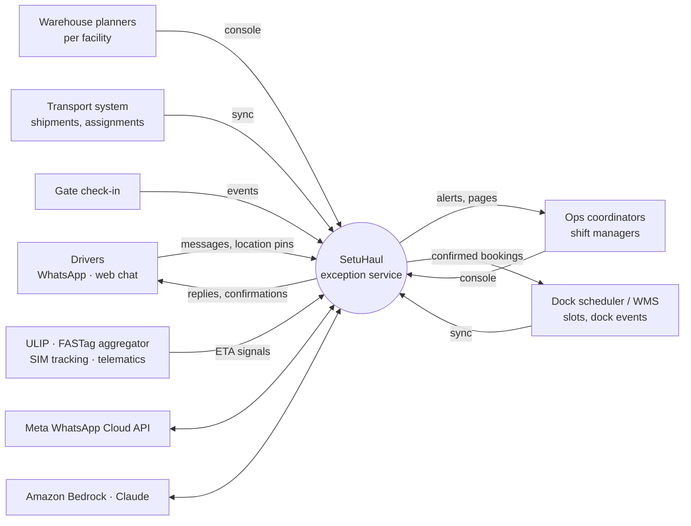
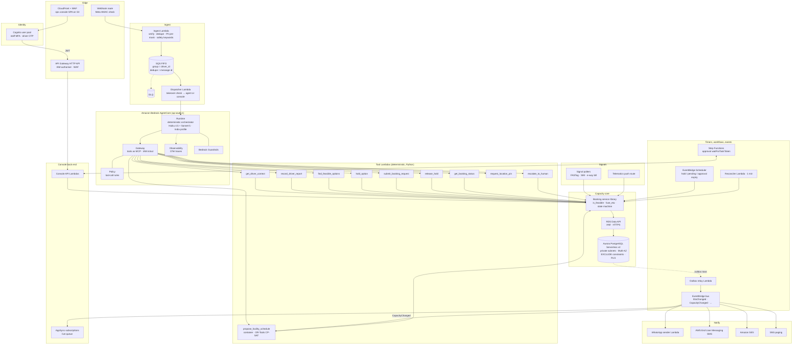

# Phase 2 · Design — Complete Architecture and AWS Services

> **Revised after external review (17 Nov 2026).** Where this file and `06_review_response.md` differ, `06_review_response.md` wins. Key changes: JWT for people / IAM for services; India-only models (`in.anthropic.claude-sonnet-5`, `in.anthropic.claude-haiku-4-5`); deterministic orchestration (no autonomous tool selection); `submit_booking_request` replaces `confirm_booking`; select → read-back → explicit yes before any hold; Data API = IAM + Secrets Manager, RLS set inside each transaction; outbox is at-least-once; AgentCore Memory deferred; truck-level exclusion constraint; MVP vertical slice.

Region **ap-south-1 (Mumbai)**, Multi-AZ. Backups are copied to **ap-south-2 (Hyderabad)**. Three AWS accounts (dev, staging, prod) under AWS Organizations. Everything is defined in AWS CDK (Python).

---

## 1. System context



## 2. Container view



## 3. Component catalogue

| Component | AWS service and configuration | Responsibility | LLM? |
|---|---|---|---|
| Ops console | S3 + CloudFront (OAC), AWS WAF, React SPA | Queue, approvals, takeover chat, facility board, pause switch | No |
| Identity | **Cognito user pool**: groups `ops`, `shift-manager`, `planner-<facility>`, `dispatcher-<carrier>`, `driver`; MFA for staff; passwordless OTP for web drivers. Issues **JWTs**. No identity pool | Sign-in for every person | No |
| API edge | **API Gateway HTTP API**. Console routes use the **JWT authoriser** (Cognito), then FastAPI RBAC (group) + ABAC (facility scope). Partner and service routes use `AWS_IAM`. The `/webhook/whatsapp` route verifies the Meta HMAC. WAF rate rules (production) | Single entry point | No |
| Ingest | Lambda (Python 3.13, arm64, outside VPC). Verifies the HMAC and replay window, normalises text, **pre-masks PII**, runs the safety keyword check, writes the masked message, enqueues | Fast ack (< 1 s), ordering, dedupe | No |
| Queue | **SQS FIFO**, `MessageGroupId = driver_id`, `MessageDeduplicationId = external_message_id`, redrive to a DLQ after 3 tries | Per-driver ordering, dedupe | No |
| Dispatcher | Lambda. If `chat_threads.human_active` or the facility is paused → route to the console (AppSync). Else `InvokeAgentRuntime` (SigV4) with `session_id = thread_id` | Takeover enforcement (eval D13) | No |
| Agent | **AgentCore Runtime** (Strands harness, container) running a **deterministic orchestrator**: Haiku 4.5 (India profile) extracts; Python picks the operation from the state machine and calls tools via Gateway; Sonnet 5 (India profile) phrases the reply. Grounding post-check before send. Degraded template mode on failure | Extraction and phrasing only | **Yes** |
| Conversation state | **PostgreSQL** (threads, messages, shown options, settled facts, handback summaries). AgentCore Memory is **deferred** until long-term preferences add value | Context across turns | No |
| Tool gateway | **AgentCore Gateway** exposes the tool Lambdas as MCP tools. Inbound IAM from the Runtime role; outbound IAM to Lambda. **Policy in AgentCore** rules (e.g. `submit_booking_request` only after `hold_option` in the same session) | Controlled tool surface | No |
| Guardrails | **Bedrock Guardrails**: sensitive-information filter (mask), prompt-attack filter, denied topics (penalties, legal, other drivers' data) | Defence in depth | — |
| Tools | 10 Lambda functions (Python, arm64, outside VPC). DB via **RDS Data API**. Contracts in `04_tool_contracts_and_states.md` | Deterministic business logic | No |
| Scheduler tool | Lambda **container image** with OR-Tools 9.15. 3,538 MB (2 vCPU). Timeout 15 s, solver limit 5 s, dispatch fallback | Facility re-sequence proposals | No |
| System of record | **Aurora PostgreSQL Serverless v2** (PostgreSQL 18.x, minimum 18.3: the first version the RDS Data API supports on 18, available in Mumbai and Hyderabad; decision T33), writer + reader in two AZs, min 0.5 / max 8 ACU (prod); min 0 auto-pause (dev, test). Private subnets, no public access, KMS, IAM auth, Data API enabled, PITR 7–35 days | Integrity, state, audit | No |
| DB access | **RDS Data API**: IAM authorises the call; DB credentials from **Secrets Manager**; writer-only; 1 MiB responses. Session state is reset between calls, so every scoped operation runs `BeginTransaction` → `SET LOCAL ROLE setuhaul_console` + `set_config('app.facility_scope', <JWT claim>, true)` → queries → `Commit`. Never the master user (superusers bypass RLS) | No VPC Lambdas, no proxy | No |
| Timers | **EventBridge Scheduler** one-time schedules: hold expiry (+3 min), pending expiry, approval expiry, escalation ack due. Handlers are idempotent. A reconciler Lambda every minute catches anything missed | Time-based transitions | No |
| Approvals | **Step Functions** Standard: `waitForTaskToken` until a console decision or timeout. Timeout leads to the safe default | Human-in-the-loop waits | No |
| Events | **EventBridge** bus `setuhaul`: `EtaChanged`, `CapacityChanged`, `BookingStateChanged`, `EscalationRaised`, `ApprovalRequested`. The outbox relay publishes committed DB events (no dual-write) | Decoupling | No |
| Notifications | WhatsApp sender Lambda (Meta Cloud API; token in Secrets Manager), **AWS End User Messaging** SMS fallback, **SES** e-mail, **SNS** paging. **At-least-once**: the consumer records `(notification_id, channel)` before and after sending; delivery status written back | No lost events; duplicates suppressed | No |
| Live console | **AppSync** GraphQL subscriptions (IAM auth) for the queue, takeover chat and facility board | Real-time humans | No |
| Signals | EventBridge Scheduler pollers (FASTag via a ULIP partner, SIM provider, e-way bill) per shipment inside the horizon; a telematics push route (IAM or HMAC) | Independent ETA evidence | No |
| Drive-time matrix | Table in Aurora, built offline with self-hosted Valhalla (OSM India extract) in a CodeBuild job | ETA from a plaza or pin | No |
| Secrets | Secrets Manager (WhatsApp token, partner API keys, HMAC secret), rotation where the provider allows | — | — |
| Observability | AgentCore Observability (OTel) → CloudWatch Logs, Metrics and X-Ray. Embedded-metric-format business metrics. Dashboards and alarms (`05_agent_observability_cost.md`) | One trace per message | — |
| Security services | GuardDuty, Security Hub (FSBP, CIS), Inspector (Lambda, ECR), Config, CloudTrail (org trail), Macie on export buckets, KMS CMKs per data class | — | — |
| Evals | CodeBuild nightly scenario replay plus **AgentCore Evaluations** online sampling | Quality gates | Judge |
| Load test | Locust master and workers on ECS Fargate (staging only) | Performance proof | — |

## 4. Network and trust boundaries

- **No NAT gateway and no interface endpoints in the hot path.** Lambdas run outside the VPC and reach Aurora only through the **RDS Data API** (IAM-authorised HTTPS calls; database credentials from Secrets Manager). Aurora sits in private subnets with no inbound route except AWS-managed Data API access. This cuts NAT plus 4–6 endpoints × 2 AZs (≈ $19 per endpoint per month in Mumbai, plus NAT) and removes a class of misconfiguration.
- **AgentCore Runtime** runs in the default public network mode, calling Bedrock and Gateway over AWS-signed requests. If a later security review requires VPC mode, add endpoints then.
- **Trust boundaries:**
  1. Internet → WAF and API Gateway (HMAC or SigV4).
  2. Ingest → agent (masked text only).
  3. Agent → tools (IAM, Policy, and ownership checks in each tool).
  4. Tools → DB (Data API, IAM, RLS, constraints).
  5. Humans → console (Cognito MFA → IAM).

## 5. Key runtime flows

### 5.1 Delay report → options → booking (happy path)

```mermaid
sequenceDiagram
  autonumber
  participant D as Driver (WhatsApp)
  participant I as Ingest + SQS
  participant A as Agent (Runtime)
  participant T as Tools (Gateway)
  participant DB as Aurora
  D->>I: "Traffic after Shahpura. Reaching around 11:20. Any slot after 12?"
  I->>I: HMAC ok · dedupe · mask · safety=no
  I->>A: invoke(session=THR001, masked text)
  A->>T: get_driver_context()
  T->>DB: driver by phone → SHP1006, APT1006 (D4 10:00)
  A->>T: record_driver_report{eta 11:20, earliest 12:00, intent ASK_OPTIONS}
  T->>DB: eta_signal + fuse_eta → 11:20 HIGH · APT1006 AT_RISK
  A->>T: find_feasible_options()
  T->>DB: is_feasible over docks → [D1 13:00, D2 13:00, D3 13:00] v=5123 (+ assignment-conflict flag)
  A-->>D: "Your 10:00 slot can't work with an 11:20 arrival. Free now (not reserved): 1) D1 13:00 2) D2 13:00 3) D3 13:00. Reply 1–3."
  D->>I: "2"
  I->>A: invoke
  A->>T: hold_option(opt-2, idem)
  T->>DB: place_hold() → advisory lock · re-check · INSERT HOLD → ok
  A->>T: submit_booking_request(hold, idem)
  T->>DB: re-check · appointment PENDING (TTL) · old APT1006 replaced · outbox
  A-->>D: "Requested D2 13:00–13:55 (ref APT-…). The warehouse confirms by 09:55; I'll message you either way."
```

For SHP1006 specifically, the assignment-conflict flag (DRV006 also on SHP1021) makes the tool return `requires_human = CONTRADICTORY_DATA`. The agent then shows no bookable options and escalates instead. The happy path above shows the generic flow.

### 5.2 Two drivers, one slot

The losing `hold_option` hits the exclusion constraint (serialised by the per-dock advisory lock). The tool returns `LOST` plus freshly computed options in the same call. The agent says: *"Another truck took D2 13:00 a moment ago. I can offer D4 13:00 or D2 14:00."* Proven at N = 200 (VAL).

### 5.3 ETA signal → at-risk → re-plan

FASTag crossing → poller → `eta_signals` → `fuse_eta` → `EtaChanged` (> 15 min) → booking `AT_RISK`? → proactive WhatsApp: *"You crossed Shahpura toll at 10:42; your 11:00 slot won't work. Options…"* → `CapacityChanged` → debounced `propose_facility_schedule` → auto-apply unconfirmed or at-risk moves; on-time confirmed moves go to a planner approval (Step Functions).

### 5.4 Dock breakdown

The planner records a BREAKDOWN in the console. The service marks overlapping bookings `AT_RISK` and inserts the BLOCK occupancy in the same transaction (the exclusion constraint guarantees nothing is left overlapping). It then re-plans the facility (scheduler), notifies affected drivers with options, and escalates bookings with no option.

### 5.5 No slot → escalation → human

`find_feasible_options` returns none, so `escalate_to_human(NO_FEASIBLE_SLOT)` builds the hand-off record. EventBridge then pushes it to the AppSync queue and SNS pages if CRITICAL. An ack-due schedule is created. The driver gets a time-bound message. The coordinator acts in the console, and the action is validated by the same booking service.

### 5.6 Safety takeover

The safety keyword or flag sets `human_active`. The dispatcher stops invoking the agent. A fixed safety message is sent. The shift manager is paged and calls the driver. On handback, a summary is written to the thread record in PostgreSQL and `human_active` is cleared.

## 6. Environments, CI/CD and repository layout

| Environment | Account | Notes |
|---|---|---|
| dev | `setuhaul-dev` | Aurora min 0 ACU (auto-pause); stub WhatsApp; synthetic data |
| staging | `setuhaul-staging` | Prod-like; Locust; FIS experiments; nightly evals; Meta test number |
| prod | `setuhaul-prod` | Multi-AZ; deletion protection; backups copied to ap-south-2 |

**Pipeline (CodePipeline or GitHub Actions with OIDC to IAM):**
1. lint, unit, contract
2. Bandit, Semgrep, pip-audit, gitleaks
3. `cdk synth` + cdk-nag + Checkov
4. Postgres integrity suite (`validate_schema.py` against an ephemeral Postgres)
5. deploy to staging
6. scenario evals (PR smoke)
7. ZAP API scan
8. manual approval
9. prod canary deploy (Lambda aliases with CodeDeploy linear; AgentCore Runtime version alias), with automatic rollback on alarms

```text
setuhaul/
  infra/                    # CDK app: stacks per layer (edge, identity, data, agent, tools, async, observability, security)
  services/
    core/                   # booking library: is_feasible, fuse_eta, state machine, repository (Data API + local psycopg)
    tools/                  # one handler per tool, JSON schemas, idempotency wrapper
    ingest/ dispatcher/ outbox/ reconciler/ notifier/ signals/
    scheduler/              # OR-Tools container
  agent/                    # Strands agent: prompts (versioned), routing, grounding check, degraded templates
  console/                  # React SPA
  db/                       # schema.sql, migrations (sqitch/alembic), seed loader
  evals/                    # scenarios, assertions, judge prompt, runner
  loadtest/                 # locustfiles
  docs/
```

## 7. Cost model (production, Mumbai)

Prices marked **✓** come from the AWS public price list for ap-south-1 (downloaded 17 Nov 2026). Others are list prices not region-checked (**~**) or estimates (**est**).

| Line | Basis | 100 conversations/day | 1,000 conversations/day (10×) |
|---|---|---:|---:|
| Aurora Serverless v2 | **✓ $0.18 / ACU-h**; writer + reader, avg ≈ 1.25 ACU total (floor 1.0) | ~$165 | ~$260 (avg 2 ACU) |
| Aurora storage + I/O | **✓ $0.11 / GB-mo**, **✓ $0.22 / M I/O**; 10 GB, 30–150 M I/O | ~$8 | ~$35 |
| RDS Data API | **✓ $0.397 / M requests**; ~3 M / 30 M per month | ~$1 | ~$12 |
| RDS Proxy | Not used (would be **✓ $0.023 / ACU-h** with an 8-ACU minimum ≈ $134) | $0 | $0 |
| NAT / interface endpoints | Not used (endpoint **✓ $0.013 / h** per AZ) | $0 | $0 |
| Bedrock Claude (India profile, +10 % regional) + Guardrails | ≈ $0.04 per conversation with deterministic orchestration (fewer Sonnet calls; **confirm India prices in console**) | ~$120 | ~$1,200 |
| AgentCore Runtime, Gateway (Memory deferred) | ✓ list (Phase 1 §7a); ~20 active vCPU-s + ~0.3 GB-h per conversation | ~$20 | ~$200 |
| Lambda | **✓ $0.0000133 / GB-s** (arm64), **✓ $0.20 / M requests** | ~$5 | ~$40 |
| API Gateway, SQS, EventBridge, Scheduler, Step Functions, AppSync | ~ list | ~$10 | ~$60 |
| CloudWatch logs, metrics, alarms, X-Ray | **✓ $0.67 / GB** logs, **✓ $0.30 / metric**, **✓ $0.10 / alarm**, **✓ $0.00000075 / span** | ~$35 | ~$120 |
| Cognito | **✓ $0.015 / MAU** Essentials; ~360 MAU | ~$5 | ~$15 |
| WAF, Shield Std, KMS, Secrets Manager | ~ list | ~$25 | ~$35 |
| GuardDuty, Security Hub, Inspector, Config | est | ~$40 | ~$80 |
| S3, CloudFront (console) | est | ~$3 | ~$5 |
| **AWS total** | | **≈ $440 / month** | **≈ $2,060 / month** |
| Outside AWS | Meta WhatsApp messaging fees; FASTag / SIM vendor fees (quotes pending) | — | — |

**Cost levers already applied:**
- Data API instead of proxy, NAT and endpoints (saves ≈ $200+ / month at this scale).
- arm64 Lambdas.
- Haiku for extraction.
- Prompt caching.
- Deterministic replies for confirmations and status checks.
- Dev and test Aurora at 0 ACU when idle.

**Next lever if needed:** drop the Aurora reader in prod (≈ −$65 / month) and accept a slower failover (RTO ≤ 30 min still met).

## Sources

- Mumbai prices: AWS public price list (`pricing.us-east-1.amazonaws.com/offers/v1.0/aws/{AmazonRDS,AmazonVPC,AmazonCloudWatch,AWSLambda,AmazonCognito}/current/ap-south-1/index.json`)
- [Aurora PostgreSQL supports RDS Data API for Serverless v2 (Dec 2023)](https://aws.amazon.com/about-aws/whats-new/2023/12/amazon-aurora-postgresql-rds-data-api)
- [RDS Proxy pricing (8-ACU minimum for Serverless v2)](https://aws.amazon.com/rds/proxy/pricing)
- [Aurora Serverless v2 scale-to-zero](https://docs.aws.amazon.com/AmazonRDS/latest/AuroraUserGuide/aurora-serverless-v2-auto-pause.html)
- [AgentCore supported regions](https://docs.aws.amazon.com/bedrock-agentcore/latest/devguide/agentcore-regions.html) · [AgentCore pricing](https://aws.amazon.com/bedrock/agentcore/pricing/)
