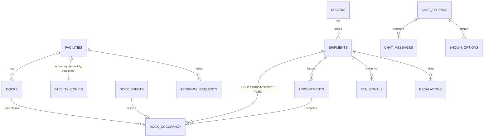

# Phase 2 · Design — Data Model

> **Revised after external review (17 Nov 2026).** Where this file and `06_review_response.md` differ, `06_review_response.md` wins. Key changes: JWT for people / IAM for services; India-only models (`in.anthropic.claude-sonnet-5`, `in.anthropic.claude-haiku-4-5`); deterministic orchestration (no autonomous tool selection); `submit_booking_request` replaces `confirm_booking`; select → read-back → explicit yes before any hold; Data API = IAM + Secrets Manager, RLS set inside each transaction; outbox is at-least-once; AgentCore Memory deferred; truck-level exclusion constraint; MVP vertical slice.

The DDL is `schema.sql` (23 tables). It is validated on PostgreSQL 18 by `validate_schema.py`, and the results are in `validation_results.md`. The target is Aurora PostgreSQL 18.3+ (decision T33), the same major version as the local evidence; the Aurora run itself is gate G1 (step 6). The schema uses only standard features: `btree_gist`, exclusion constraints, PL/pgSQL triggers and RLS.

## 1. The one idea: every claim on dock time is a row



`dock_occupancy (dock_id, during tstzrange, kind, active)` has kinds **HOLD** (expires), **APPOINTMENT**, **BLOCK** (breakdown or maintenance) and **FIXED** (truck in dock). One constraint enforces "one truck per dock at a time" across all four:

```sql
CONSTRAINT ex_one_truck_per_dock EXCLUDE USING gist (dock_id WITH =, during WITH &&) WHERE (active)
```

Slots (`appointment_slots`) remain as the planner's grid, and they cannot overlap either. They are no longer the integrity mechanism, because a 75-minute unload spans slots (audit A04).

## 2. Guards and the audit gaps they close

| Guard | Closes |
|---|---|
| `ex_one_truck_per_dock` (exclusion) | Double booking, spill-over unloads, bookings on blocked docks, overlap with an overrunning truck (A04, A08, A11, A12) |
| `ex_one_dock_per_truck` (exclusion on `vehicle_id`, `during`, `shipment_id <>`) | The same truck holding or booking two docks at overlapping times for different shipments (review P1). The vehicle is copied from the shipment by trigger, so callers cannot spoof it. **It does not validate the assignment itself:** whether this driver and truck are really assigned to this shipment is TMS data, checked by `assignment_conflict` and escalated as CONTRADICTORY_DATA (see `08_signoff_and_backlog.md` §3) |
| `trg_occupancy_compat` (trigger) | Wrong facility, overweight, non-reefer for a reefer load, non-heavy for a heavy load, cancelled shipment (A03; gaps 4–6) |
| `ux_one_active_hold_per_shipment` | One driver hoarding several holds |
| `ux_current_active_appointment_per_shipment` | Two current bookings for one shipment |
| `UNIQUE (channel, external_message_id)` + `driver_exceptions.dedupe_key UNIQUE` | Duplicate messages and exceptions (A18, A19) |
| `notifications` state machine: `UNIQUE (source_event_id, channel)`, `RETRY` requires `next_retry_at`, `UNKNOWN` state for ambiguous provider timeouts, transition trigger, `unknown_resend_count` 0–1 and never decreasing, `reap_stuck_sends()` | Duplicate notifications from relay retries; unscheduled retries (re-review C) |
| `appointments.pending_expires_at` required when pending | Pending requests that never expire (A23) |
| `booking_events` append-only trigger | Rewritten history (A12) |
| `facilities.schedule_version` (trigger-bumped) | Stale options detected at hold time |
| `facilities.automation_paused` | HITL pause switch enforced in the database |
| RLS (ENABLE + **FORCE**, `USING` + `WITH CHECK`) on **every facility-owned table**: dock_occupancy, appointments, shown_options, approval_requests, escalations, outbox, notifications, booking_events, plus chat threads, chat messages, `eta_signals`, `driver_exceptions`, `tracking_consents`, and the mirror tables `shipments`, `appointment_slots`, `dock_events` (driver or facility). Scope is set **inside each Data API transaction** | Cross-facility reads and writes. Missing scope returns 0 rows and blocks writes. No app role is SUPERUSER or BYPASSRLS; background jobs set an explicit scope. Superusers bypass RLS, so they are used for migrations only |
| `place_hold()` with `pg_advisory_xact_lock(dock)` | Clean "lost" instead of deadlock under contention |
| All functions run with `SET search_path` | Search-path hijack. This also fixed a bug found by the validator |
| Least-privilege grants: PUBLIC has nothing; capacity written only via `SECURITY DEFINER` functions owned by `setuhaul_rpc` (NOBYPASSRLS, pinned `search_path`); column-level writes per role; no DELETE | A tool service or console mutating business state outside the intended operation (fourth review P0) |

## 3. Proof on the real snapshot (from `validation_results.md`)

Loading the 4 Aug snapshot (physical reality first, then bookings in booking order), the constraints **rejected exactly the bookings the Phase 1 audit flagged**:

| Rejected | Why |
|---|---|
| APT1004 (SHP1004, D2 09:00) | Overlaps SHP1002, still unloading on D2 until ~09:28 (A11) |
| APT1005 (SHP1005, D3 09:00) | 20,500 kg > D3's 20,000 kg (A03). It would also have hit the breakdown (A08) |
| APT1015A (SHP1015, D5 17:00) | 60 min unload + changeover runs into maintenance from 18:00 |
| APT1014A (SHP1014, D1 11:00) | 21,000 kg > D1's 20,000 kg (A03, A05) |

Re-validated after the review (truck-level guard, FORCE RLS, Data-API-style scoped transactions):
- Same truck on D1 and D2 at overlapping times for two shipments: **rejected** by `ex_one_dock_per_truck`.
- RLS: scope GGN = 1 row, both facilities = 2, unset = 0, non-superuser owner = 0, system role = 2. **All pass.**

Concurrency results:
- 10 / 50 / 200 parallel holds on one window, 30 / 20 / 10 rounds: **exactly one winner every round, 0 deadlocks**.
- 150 random overlapping holds: **0 overlaps**.

## 4. Migrations and data ownership

- Migrations are versioned (Alembic or sqitch). `schema.sql` is the baseline.
- **Reference data** (carriers, drivers, vehicles, shipments, slots) is owned by the TMS and WMS and synced by a nightly job plus change events. This service owns occupancy, appointments it creates, conversations, signals, escalations and approvals.
- **Driver and vehicle double-assignment** is *flagged*, not constrained, because the TMS owns assignments and the seed contains real conflicts (A01). The service refuses to auto-book a flagged shipment instead.
- **PII.** `chat_messages.body_masked` only. Raw text is stored encrypted in S3 with 30-day retention. `eta_signals.position_geohash` is never exposed to the agent.
