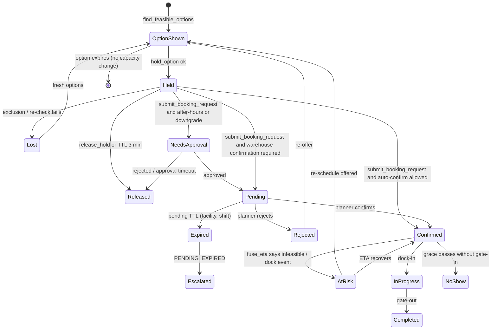
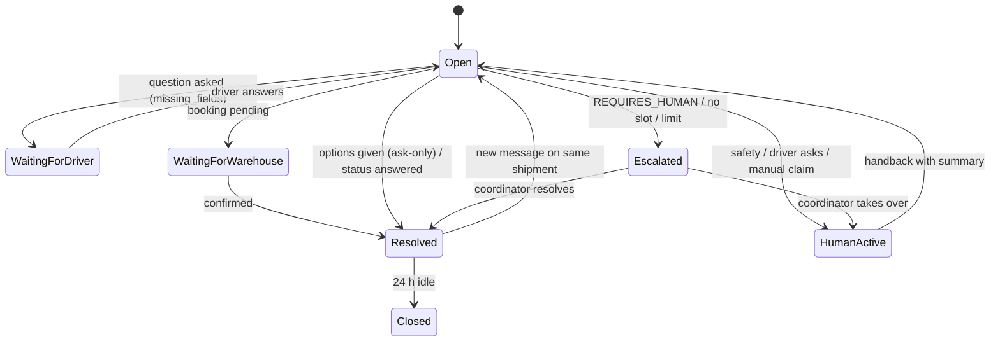
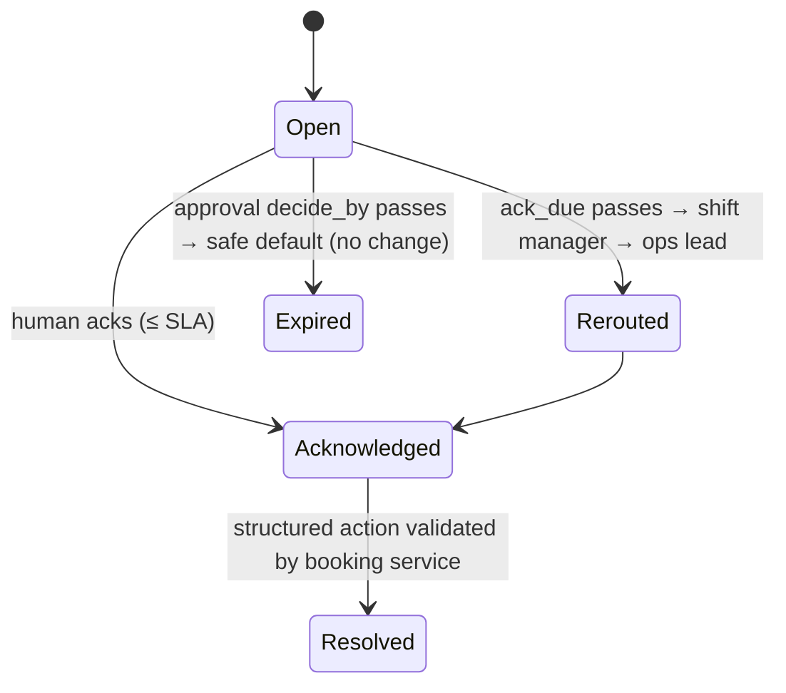

# Phase 2 · Design — Tool Contracts and State Machines

> **Revised after external review (17 Nov 2026).** Where this file and `06_review_response.md` differ, `06_review_response.md` wins. Key changes: JWT for people / IAM for services; India-only models (`in.anthropic.claude-sonnet-5`, `in.anthropic.claude-haiku-4-5`); deterministic orchestration (no autonomous tool selection); `submit_booking_request` replaces `confirm_booking`; select → read-back → explicit yes before any hold; Data API = IAM + Secrets Manager, RLS set inside each transaction; outbox is at-least-once; AgentCore Memory deferred; truck-level exclusion constraint; MVP vertical slice.

Tools are invoked by the **deterministic orchestrator** (Python state machine), not chosen by the LLM. They are still exposed through AgentCore Gateway so Policy, IAM and tracing apply uniformly. Every tool:
- is a Lambda behind **AgentCore Gateway** (MCP) with a strict JSON schema;
- takes the caller's identity from the **session**, never from its arguments;
- returns structured data plus a short `say_hint` the agent may paraphrase;
- uses an idempotency key on every write.

## 1. Common envelope

Every tool request carries:

```json
{ "session": {"thread_id": "THR001", "turn_id": 7, "principal": "driver:DRV006", "trace_id": "…"},
  "args": { … } }
```

Every response has this shape:

```json
{ "status": "OK | NEEDS_INFO | LOST | NOT_FEASIBLE | REQUIRES_HUMAN | ERROR",
  "data": { … },
  "missing_fields": ["latest_finish_kind"],
  "requires_human": null | {"reason_code": "CONTRADICTORY_DATA", "detail": "…"},
  "say_hint": "…",
  "schedule_version": 5123 }
```

- **Idempotency.** `idem_key = sha256(thread_id | tool | canonical(args) | turn_id)`. A repeat call with the same key returns the stored response.
- **Ownership.** Every tool checks that the shipment belongs to the session's driver, or that a console principal has the facility in scope. Otherwise it returns `ERROR: FORBIDDEN`.
- **Pause.** If the facility's automation is paused, write tools return `REQUIRES_HUMAN: AUTOMATION_PAUSED`.

## 2. Tools

| Tool | Kind | Arguments (schema essentials) | Returns | Notes |
|---|---|---|---|---|
| `get_driver_context` | read | — | driver, `live_shipments[]` (ref, status, destination, current appointment, priority, capability, ETA + confidence), `needs_shipment_choice` | First call of every thread |
| `record_driver_report` | write | The strict extraction schema (`docs/1-frame/02_variables.md` §6c) + `shipment_id?` | `effective_eta`, `eta_confidence`, `eta_window`, `appointment_at_risk`, `missing_fields[]`, `flags[]` (e.g. OPTIMISTIC_DECLARATION) | Runs validation and `fuse_eta`. Writes `eta_signals` (DRIVER_DECLARED) and exceptions (deduped). Safety flag leads to REQUIRES_HUMAN |
| `find_feasible_options` | read + records options | `shipment_id`, `max_options` (≤ 3), `earliest_start?`, `latest_finish?` | `options[]`: `{option_id, dock_code, start_local, end_local, needs_approval, reason}`, `rejections_summary`, `requires_human?` | Runs `is_feasible`. Stores `shown_options` with `schedule_version` and a 5-min expiry. Assignment conflict leads to REQUIRES_HUMAN |
| `hold_option` | write | `option_id` (must be shown in this thread), `explicit_confirmation: true` | `HELD {hold_expires_at}`, or `LOST {fresh_options[]}`, or `NOT_FEASIBLE {reason, fresh_options[]}` | `place_hold()`: advisory lock, re-check, exclusion |
| `submit_booking_request` | write | `hold_id` | `PENDING {pending_expires_at}`, or `CONFIRMED {appointment_ref}`, or `NEEDS_APPROVAL {approval_id, decide_by}` | Re-runs `is_feasible`. Replaces the old appointment (history chain). Writes outbox events |
| `release_hold` | write | `hold_id` | `RELEASED` | When the driver changes their mind |
| `get_booking_status` | read | `shipment_id` | current appointment and status, pending deadline, escalation status | Status-only threads need no LLM reasoning (template reply) |
| `request_location_pin` | write | `shipment_id`, `reason` | `REQUESTED` | Sends a WhatsApp `location_request_message`. Consent recorded on the first share |
| `escalate_to_human` | write | `reason_code`, `mode` (DECIDE / TAKE_OVER), `driver_last_message`, `what_driver_was_told` | `escalation_id`, `ack_due_at`, `driver_message_hint` | Builds the full hand-off record **server-side** from the DB. The agent supplies only two text fields |
| `propose_facility_schedule` | read + proposal | `facility_id`, `trigger` | `proposal_id`, `moves[]` with reasons, `objective`, `solver_status`, `auto_applicable[]`, `needs_approval[]` | Usually called by events, not the agent. Structured input only |

Not exposed to the agent, ever: cancelling or moving another driver's booking, changing priority, editing dock events or rules, approving anything.

## 3. Agent-side rules (enforced in code and in Policy in AgentCore)

| Rule | Enforcement |
|---|---|
| R1 | `hold_option` only with an `option_id` returned by `find_feasible_options` in the same thread, **after** the read-back ("You selected D2 at 13:00… shall I request it?") received an explicit yes. A bare selection ("2") only moves the thread to SELECTED |
| R2 | `submit_booking_request` only after a successful `hold_option` in the same session |
| R3 | No write tool while `missing_fields` is non-empty (except `record_driver_report` and `escalate_to_human`) |
| R4 | `REQUIRES_HUMAN` → the next call must be `escalate_to_human` |
| R5 | **Grounding post-check:** every time, dock code and reference in the reply must appear in the tool outputs of this turn. Otherwise regenerate once, then fall back to a template |
| R6 | Max 3 clarification turns, then `escalate_to_human(CLARIFICATION_LIMIT)` |

## 4. State machines

### 4.1 Dock claim / booking



### 4.2 Conversation thread



### 4.3 Approval and escalation



## 5. Error codes the agent must handle

| Code | Agent behaviour |
|---|---|
| `LOST` | Apologise briefly, give the reason, offer `fresh_options` |
| `NOT_FEASIBLE` | Explain the reason (from `reason`), offer alternatives |
| `OPTION_EXPIRED` | Re-run `find_feasible_options` and say that availability changed |
| `NEEDS_INFO` | Ask only for `missing_fields`, combined into one question |
| `REQUIRES_HUMAN` | Call `escalate_to_human`, then send `driver_message_hint` |
| `FORBIDDEN` | "I can only help with shipments assigned to you." No details |
| `ERROR` (5xx) | Retry once with the same idempotency key. If it fails again, use the degraded template and alert |
