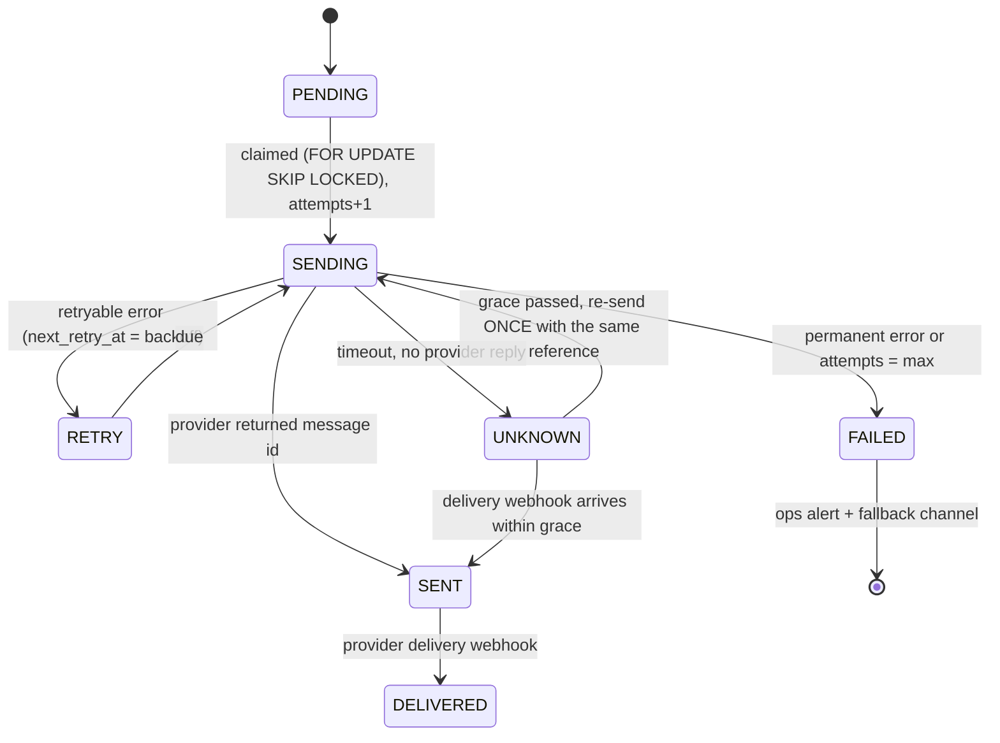

# Phase 2 · Design — MVP Acceptance Gate and Verification (re-review addendum)

The re-review approved the architecture direction, subject to four verification points, an explicit MVP acceptance gate, and five more decisions. It also asked one question to answer with evidence: *why an LLM for this operation instead of code, and how do we prove it was justified?* This file covers all of that. Points that could be proven now were proven on PostgreSQL 18 (`validation_results.md` §5–6). The rest are Build-phase acceptance tests.

---

## 1. The four verification points

### A. Facility-level RLS — ✅ proven on all 16 facility- or driver-owned tables, plus least-privilege grants

| Requirement | How it is met | Evidence |
|---|---|---|
| Every facility-owned record carries `facility_id` | `dock_occupancy`, `approval_requests`, `escalations`, `outbox` (column added), `notifications` (new), `booking_events`. `appointments` and `shown_options` resolve the facility through the dock. Conversation tables resolve it through the shipment or the driver | `schema.sql` |
| RLS on all relevant tables, including outbox and audit | ENABLE + **FORCE** on all of the above, for **reads and writes** (`USING` + `WITH CHECK`). `chat_threads` and `chat_messages` are visible to the owning driver session, or to staff scoped to the shipment's facility | `schema.sql` |
| Application roles cannot bypass RLS | `setuhaul_console`, `setuhaul_agent` and `setuhaul_system` are `NOSUPERUSER NOBYPASSRLS`. The earlier BYPASSRLS system role is **removed**: background jobs set an explicit scope listing the facilities they serve | Validator: "App roles that are SUPERUSER or BYPASSRLS = 0" |
| Missing context → denial | `scope_allows()` returns false when the scope is unset or empty. Unset scope shows 0 rows in escalations, outbox, notifications, booking_events, appointments and shown_options | Validator §5 (6 checks) |
| Writes outside scope are denied | An agent scoped to GGN inserting a JAI dock block is rejected by `WITH CHECK` | Validator §5 |
| Superuser / BYPASSRLS caveat | Superusers and the RDS master user always bypass RLS. They are used **for migrations only**. A CI check fails if any app role gains either attribute | Validator §5; pipeline rule |

**Third review:** `eta_signals`, `driver_exceptions` and `tracking_consents` now have driver-or-facility RLS (`driver_or_staff()`), with 25 read and write checks, including one driver reading or writing another driver's records (validator §5, all pass). A driver session is strict: it never falls back to facility scope.

**Fourth review: mirror tables covered (B-RLS-2 closed).** `shipments` (driver session: own shipments only; staff: destination facility in scope), `appointment_slots` and `dock_events` (facility through the dock) now have FORCE RLS. No `SECURITY DEFINER` lookup helper was needed: the dependent policies and the compatibility trigger look the shipment up under the same caller context, so a lookup succeeds exactly when the caller may see the shipment. One trap was closed: the compatibility trigger would have silently *passed* on a hidden shipment (a NULL row makes every check NULL); it now raises `SHIPMENT_NOT_VISIBLE`. 15 checks (validator §5b) prove driver A sees only their shipments, GGN staff see no JAI shipments, slots or dock events, legitimate driver and staff access through dependent policies still works, and driver A's session cannot hold a slot for driver B's shipment.

**Least privilege (fourth review P0).** RLS limits *which rows*; grants now limit *which operations*. PUBLIC has no table access and no EXECUTE. Capacity (`dock_occupancy`) is written only through `SECURITY DEFINER` functions owned by `setuhaul_rpc` (NOBYPASSRLS, NOLOGIN, no members, pinned `search_path`), so RLS still applies inside them with the caller's scope. Other writes are column-level per role: the agent cannot approve, read task tokens, clear the human-takeover flag, pause a facility or touch notifications; no role can DELETE. 20 checks (validator §7). The concurrency tests in §2–§3 now run as the agent role through `place_hold()`, not as superuser. Reference tables (carriers, drivers, vehicles, facilities, facility_config, docks) and `idempotency_keys` stay without RLS by decision. A coverage check fails if any new table is neither RLS-forced nor on that reasoned list.

### B. India-only model inference — Build spike, with exit criteria

| # | Check | How | Pass condition |
|---|---|---|---|
| B1 | Profiles exist in ap-south-1 | `aws bedrock list-inference-profiles --region ap-south-1` and `get-inference-profile` for `in.anthropic.claude-sonnet-5` and `in.anthropic.claude-haiku-4-5-20251001-v1:0` | Both returned. Destination regions are only ap-south-1 and ap-south-2 |
| B2 | Requests really use the `in.` profile | IAM policy for the runtime role allows `bedrock:InvokeModel*` / `Converse*` **only** on the two `in.` profile ARNs (plus their underlying foundation-model ARNs in ap-south-1 / ap-south-2). An explicit **Deny** covers `global.*` profiles. Every inference trace records `inference_profile_arn` | A test call with a `global.` profile id fails with AccessDenied. 100 % of traces show an `in.` ARN |
| B3 | Other model-backed services follow the same rule | **AgentCore Evaluations' built-in evaluators are not used on production data** (their cross-region processing scope is not India-only). Online quality checks run as **custom evaluators that call the `in.` Sonnet profile**, or offline on sanitised data. Bedrock Guardrails runs in ap-south-1 on the same request. No other AI service (Comprehend, Knowledge Bases) receives driver data | Architecture review sign-off; IAM denies `bedrock-agentcore` evaluation actions on production-trace sources if built-in evaluators would leave India |
| B4 | Strands provider works with both profiles | Strands BedrockModel (boto3 Converse) calls each profile. Forced-tool extraction on Haiku 4.5 with a strict schema, or Pydantic fallback | 20/20 sample messages produce schema-valid output |

Choosing an India profile for normal inference does **not** make other AI services India-only. Each one is listed and checked (B3).

### C. Notification de-duplication — ✅ schema proven; process defined

**Fields:** `notification_id`, `source_event_id`, `channel`, `provider_message_id`, `attempts` / `max_attempts`, `next_retry_at`, `sending_started_at`, `last_error`, terminal `FAILED`.

**Constraints:**
- `UNIQUE (source_event_id, channel)`: an outbox relay retry cannot create a second notification (validator: rejected).
- `UNIQUE (channel, provider_message_id)`.
- `RETRY` requires `next_retry_at` (validator: rejected without it).

**The ambiguity is stated, not hidden.** A provider may accept a message after our call times out. That case becomes `UNKNOWN` and is never blindly re-sent. Instead:
1. Wait for the provider status webhook, up to `unknown_grace` (default 2 min).
2. Then re-send once with the same booking reference, so a duplicate reads as an identical, harmless repeat.
3. For safety and escalation messages, page a person instead of re-sending.

Consumer de-duplication reduces duplicates, but it cannot remove this case.

**Enforced, not just documented (fourth review).** `unknown_resend_count` is 0 or 1 and can never decrease; `trg_notification_transition` allows only the listed transitions and permits `UNKNOWN → SENDING` only while the counter is 0. `unknown_since` and `unknown_deadline` are required in `UNKNOWN`. A crashed worker's `SENDING` row is moved to `UNKNOWN` by `reap_stuck_sends()`, never back to `PENDING`. 14 checks (validator §8): repeated timeouts, delayed webhook, late duplicate webhook, worker crash, counter tampering.

**What each layer guarantees (third review):**

| Layer | Prevents | Does not prevent |
|---|---|---|
| `UNIQUE (source_event_id, channel)` | Creating two notifications for one event | A second delivery of the same notification |
| Consumer de-duplication (`FOR UPDATE SKIP LOCKED`, status checks) | Two workers processing one row | A provider that accepted a send we think timed out |
| Provider idempotency key, where the provider supports it | Most duplicate deliveries on re-send | Providers or channels without it |
| Human fallback for safety and escalation messages | Silent loss of a critical message | — |

**No layer, or combination, guarantees exactly-once delivery.** The design aims for at-least-once with a bounded, harmless duplicate (same reference, same text). The re-send after `unknown_grace` can still duplicate if the provider accepted the first send and its webhook was late or lost. That is accepted for routine updates; critical messages page a person instead of re-sending.

### D. Booking confirmation sequence — ✅ defined; expiry proven

`SELECT → READ_BACK → EXPLICIT_YES → HOLD → SUBMIT_REQUEST → WAREHOUSE_CONFIRMATION`

**Hold expiry and release** use three mechanisms, each enough on its own:
1. **In-transaction lazy release:** `place_hold()` deactivates expired holds that overlap the requested window. Validator: the second driver is rejected while the first hold is live, and accepted after the TTL, with the first hold released.
2. **Exact timer:** an EventBridge Scheduler one-time schedule at `expires_at` calls `release_hold` (idempotent).
3. **Reconciler:** every minute, releases any active hold past `expires_at` and alarms if it found one older than 2 min (the timer was missed).

**What the driver is told:** the hold is internal, because `submit_booking_request` normally follows in the same turn. If the driver goes silent between read-back and yes, nothing is held. If the hold expires before submission (an error path), the next message says *"That slot was released because we didn't get a confirmation in time. Here's what's free now."*

## 2. MVP acceptance gate — "Driver delay to successful appointment rescheduling"

The MVP is **done** only when every row below passes in an automated end-to-end run against the deployed MVP slice (real Cognito, real Bedrock India profiles, real SQS / Step Functions, local PostgreSQL), and every step appears in one trace.

### 2.1 Definition of done (happy path)

| # | Step | Evidence of pass |
|---|---|---|
| 1 | Driver authenticates through the supported channel | Cognito OTP (web chat) gives a JWT, verified by FastAPI; the driver id comes from the token |
| 2 | System identifies the correct driver and shipment | Single live shipment linked automatically; two shipments trigger the order-ref question (THR010 replay) |
| 3 | Haiku extracts the revised ETA | Schema-valid `record_driver_report`; trace shows `in.` Haiku profile, prompt and schema version |
| 4 | Python validates and fuses the ETA | `fuse_eta` result with source and confidence stored in `eta_signals` |
| 5 | Scheduling engine finds feasible alternatives | `find_feasible_options` returns ≥ 1 option, each passing `is_feasible`; `shown_options` rows written |
| 6 | Driver selects and explicitly confirms | SELECTED state after "2"; HOLD only after "yes" to the read-back |
| 7 | System creates an idempotent hold | `place_hold` succeeds; replaying the same request with the same idempotency key returns the same hold, with no second row |
| 8 | Booking request reaches the warehouse | `submit_booking_request` → appointment PENDING with `pending_expires_at`; Step Functions approval task appears in the console |
| 9 | Warehouse approval or rejection is handled | Approve → CONFIRMED; reject → driver offered alternatives |
| 10 | Driver receives the final outcome | Notification row SENT (or DELIVERED); driver sees the confirmed slot or the alternatives |
| 11 | Every step is traceable and auditable | One `trace_id` across all spans; `booking_events` rows for hold, request and decision with principal and role |

### 2.2 Failure scenarios that must pass

| # | Scenario | Expected behaviour | Test |
|---|---|---|---|
| F1 | Duplicate driver message (provider retry, new id, same text) | One reply, one exception. The duplicate is rejected by unique id or `dedupe_key` | Replay THR001 / THR009 |
| F2 | Concurrent dock booking | Exactly one hold wins; every loser gets LOST plus fresh options in the same turn | 50 parallel drivers on one option (validator pattern, through the API) |
| F3 | Truck already assigned elsewhere | `assignment_conflict` → no options offered as bookable → escalate CONTRADICTORY_DATA. A forced attempt is rejected by `ex_one_dock_per_truck`. The constraint stops overlapping claims for one truck; it does **not** decide whether the assignment is correct (TMS validation, `08_…` §3) | SHP1006 / SHP1021 replay + DB check |
| F4 | Expired hold | The slot becomes available to others. A late "yes" from the original driver gets fresh options | Validator lifecycle + E2E with a shortened TTL |
| F5 | LLM timeout | Retry once, then a deterministic template reply with numbered options. Booking logic unaffected | Fault-inject a Bedrock timeout |
| F6 | Warehouse approval timeout | Step Functions times out → appointment EXPIRED → driver offered alternatives → escalation PENDING_EXPIRED. No auto-approval | Shortened TTL |
| F7 | Notification delivery failure | RETRY with backoff → FAILED after max attempts → ops alert + fallback channel. A provider timeout → UNKNOWN path | Stub provider returns 5xx, then times out |
| F8 | Unauthorised facility access | A GGN-scoped planner cannot read or act on JAI bookings: API returns 403 and the DB returns 0 rows. A driver cannot act on another driver's shipment | JWT with the wrong facility claim; token of another driver |

### 2.3 Release gate (decision T30)

All of the following must hold:
- The golden dataset gates (`06_review_response.md`) pass.
- Hard gates are zero: double bookings, rule violations, unauthorised operations, duplicate mutations.
- Security tests pass: RLS suite, IAM deny on `global.` profiles, JWT tampering, prompt-injection corpus.
- Concurrency tests pass.
- F1–F8 pass.
- **Cost per resolved exception ≤ $0.08** (MVP measured on the golden set). This and ≈ $0.04 per conversation are **hypotheses until measured**. Four metrics are reported separately (`08_signoff_and_backlog.md` gate G4).
- The validator passes on the target engine, Aurora PostgreSQL 18.3+ through the Data API (gate G1, decision T33); local PostgreSQL 18 evidence alone is not enough.

## 3. Additional decisions (added to the register as T26–T30)

| # | Decision | Outcome |
|---|---|---|
| **T26** | Workflow state ownership | **PostgreSQL** owns business state (threads, options, holds, appointments, escalations, notifications). **Step Functions** owns long-running waits (warehouse approval, human decisions) and holds only ids and task tokens, never a second copy of business state. On any disagreement, PostgreSQL wins and the execution is reconciled |
| **T27** | Human approval authorisation | Approval actions are **authenticated** (Cognito JWT, role + facility scope), **expiring** (`approval_requests.expires_at`; the Step Functions task token is never exposed to the browser; the API holds it server-side), **idempotent** (`approval_id` + `decision_idem_key`; a second click returns the first result) and **re-validated** (`is_feasible` at decision time). Every decision is written to `booking_events` |
| **T28** | Model and prompt versioning | Every inference span records `model_id`, `inference_profile_arn`, `prompt_version`, `schema_version`, `policy_version`, `cfg_version`, input / output / cache tokens and latency. Prompts and schemas are versioned files in the repository. A change requires a golden-set run |
| **T29** | Failure recovery | Per dependency: timeout, retries (jittered backoff, max), circuit breaker (Bedrock, WhatsApp, tracking vendors), compensation (release hold, mark booking EXPIRED / AT_RISK, notify), and a DLQ with a documented redrive runbook. Every compensation is itself idempotent |
| **T30** | Release gate | §2.3 above |

## 4. Why an LLM here and not code, with evidence

| Operation | Choice | Why | How we prove it was justified (Build experiment) |
|---|---|---|---|
| Understand free-text driver messages ("around 2 hours late", "the second one but I must leave by 9", Hinglish) | **LLM (Haiku 4.5)** | Open-ended language; the brief says forms fail here | **Ablation:** a rules / regex extractor baseline vs Haiku on the 60-scenario golden set. Measure ETA precision / recall, intent accuracy, clarification turns, and **coordinator escalations avoided**. Haiku is kept only if it beats the baseline by a margin worth its cost (≈ $0.0045 per extraction ≈ $4.5 per 1,000 extractions on the India profile) |
| Identity, shipment linking, ETA fusion, feasibility, ranking, holds, commits, priority, timers | **Deterministic Python + PostgreSQL** | There is a right answer, and it must be auditable and repeatable | Unit and property tests, validator, concurrency tests. Zero tolerance |
| Facility re-sequencing | **OR-Tools CP-SAT** | Combinatorial optimisation | Solver spike: −32 % weighted wait vs FCFS in 1.4 s; regression replay in CI |
| Replies for options, refusals, escalations | **LLM (Sonnet 5)**, grounded | Needs clarity, tone and language matching across many situations | **A/B:** templates-only vs Sonnet on the golden set. Measure judge scores (clarity, refusal quality, language match), clarification turns and time to outcome. Sonnet is kept only where it improves outcomes. Routes where templates score the same stay templates (status and confirmations already do) |
| Status checks, confirmations, safety messages | **Templates** | Fixed content; an LLM adds risk, not value | — |
| Durable waits and approvals | **Step Functions** | Reliability, timeouts, audit | F6 test |

**Economics at production scale** (100 conversations/day):
- Total LLM spend is ≈ $120 a month, about $4 a day.
- One avoided coordinator escalation (≈ 10 min of an ops coordinator) is worth more than a day of LLM spend.
- The Build-phase ablation turns this argument into a measured number: escalations avoided per rupee.

If the rules baseline matches Haiku on the golden set, the LLM is removed from that step. That outcome is acceptable, and it is the point of the test.
