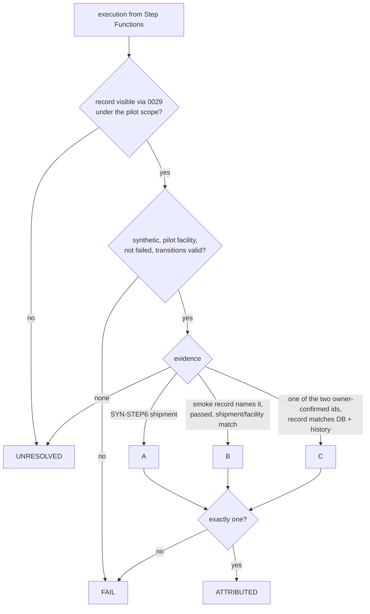

# Approval execution attribution

Every execution of `setuhaul-pilot-approval` must be attributed to auditable evidence in **exactly one** category,
or BOOKING_WORKFLOW does not pass. Code: `setuhaul/ops/renewal.attribute_executions`.

## 1. Categories

| | Category | Accepted when | Never |
|---|---|---|---|
| A | Step 6 drill | the record's shipment is `SYN-STEP6-*` (owner-approved drills) | on the id prefix alone without the record |
| B | smoke test | a smoke record (`option_d_smoke.json` or `evidence/smoke/*.json`) names the execution, passed, is for this environment, and its shipment and facility equal the record's | on a `SYN-` prefix or a time window alone |
| C | owner-confirmed manual test | the id is one of **exactly two** in `OWNER_CONFIRMED_IDS` (code constant), the owner's record names it with a confirmation, and the database record and Step Functions history match what the record says | for any other id (a code change and a review); never as smoke evidence |

Every category also requires the common record checks: a visible record (migration 0029, pilot facility scope), a
synthetic shipment, a pilot facility, the execution not FAILED/TIMED_OUT/ABORTED, and consistent transitions:
* a finished execution doesn't leave the approval OPEN;
* APPROVED means the appointment isn't pending;
* EXPIRED or REJECTED means the appointment isn't confirmed;
* APPROVED or REJECTED were decided by a person.

Verdicts: ATTRIBUTED (one category), UNRESOLVED (no record or no evidence), FAIL (a contradiction, or two categories).

## 2. The three executions found on 23 Nov 2026

Sources: Step Functions execution history and the api log group `SetuHaulPilot-LogsApi160DC9DD-lJdhKCUhs6Vv` (read
23 Nov 2026). No database record could be read from this session (see RLS_EVIDENCE_ACCESS.md), so each line below says
what is **observed** and what the gate must still **verify**.

### `73cac501-fe58-457a-80d5-b90234d56139`: Category B (documented smoke)

* Observed: started 07:30:13Z with input timeout 292 s; the decision task finished 07:31:08Z; SUCCEEDED.
  `docs/release/evidence/option_d_smoke.json` (collected 07:34:25Z, all 11 checks passed) names this execution ARN and
  approval, shipment `SYN-SHP-2172ACB8`, appointment `APT-01c31ce02a444ad79d6f43d0fa874cc0`.
* Release binding: that smoke predates the renewal format and recorded no release SHA. The gate accepts it as
  historical B and says so ("23 Nov format: release SHA not recorded"). It never counts as the fresh smoke.
* To verify: the record's shipment and facility (FAC-JAI-01) match, and the approval is APPROVED by a drill identity
  (`staff:option-d-smoke-planner`).

### `87915a37-918e-46b5-8872-8ecaa4fc7a24`: Category C (owner's failed manual test)

* Observed: started 08:11:28Z (timeout 249 s). No decision arrived; `WaitForDecision` TaskTimedOut 08:15:38Z;
  `ExpireApproval` returned outcome EXPIRED at 08:15:48Z; execution SUCCEEDED.
* The api logged five `POST /console/requests/APT-2dc6e787f98848e8902afa8b4b173f7b/decision` → **500** (08:11:22–08:12:19Z,
  request ids in `owner_attribution_20261123.json`). That's the known defect: the api had no feasibility login (fixed in `8fe6935`).
* Owner confirmation (23 Nov 2026): personally performed; authorized as Category C.
* To verify: appointment `APT-2dc6e787…`; status EXPIRED; decided by SYSTEM between 08:15:30 and 08:16:00Z; appointment
  not CONFIRMED or pending; synthetic shipment; pilot facility.

### `29ffac03-d8bd-4dac-b35c-66b0f8ebf24b`: Category C (owner's successful post-fix validation)

* Observed: started 08:36:29Z (timeout 286 s); `WaitForDecision` succeeded 08:36:39Z; SUCCEEDED. The api logged one
  `POST /console/requests/APT-89027b09ab6449d1acdd5a51c6549bc5/decision` → **200** at 08:36:30Z, 15 minutes after the fix
  was redeployed (activate-booking run 45137914143 started 08:21:05Z).
* Owner confirmation (23 Nov 2026): personally performed; authorized as Category C.
* To verify: appointment `APT-89027b09…`; APPROVED or REJECTED by a HUMAN `console_user` between 08:36:20 and 08:36:45Z;
  appointment not pending; synthetic shipment; pilot facility.

**Conclusion today:** attribution is **evidenced but not yet verified against the database**. Until 0029 is deployed and
the gate reads the records, the two C executions (and the B one) are UNRESOLVED by construction, and the renewal gate
does not pass. Nothing is labelled legitimate on log evidence alone.

## 3. The record

`docs/release/evidence/owner_attribution_20261123.json` keeps the original references unchanged: execution ARNs (account
masked), Step Functions timings and outcomes, the log group, every request id with its timestamp and HTTP status, the
owner's confirmation statement, and the expected database facts. Tests pin it:
* exactly two ids, category C, owner confirmation present;
* five 500s and one 200;
* a third id rejects the whole record;
* a database or history mismatch fails the execution.
