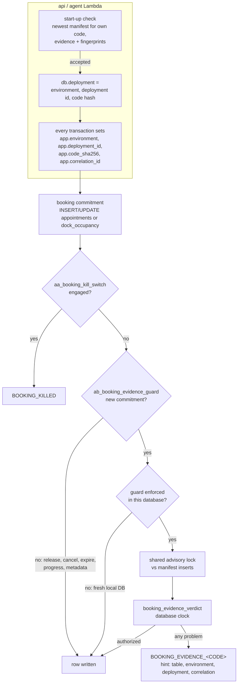

# Database-side booking evidence guard: design

Status: implemented and tested locally on branch `feature/database-booking-evidence-guard` (base `main` `e280a40`).
**Not merged, not deployed, migration not applied to any live database.** Independent of PR #5 (renewal gate).

Code: `migrations/0030_booking_evidence_guard.sql`; `setuhaul/api/db.py`, `setuhaul/aws/data_api.py` (declare the
deployment in every transaction); `setuhaul/api/app.py` (set it after the start-up check). Tests:
`tests/test_booking_evidence_guard.py`.

## 1. Existing flow and the gap

| Step | Where | When |
|---|---|---|
| Booking switch on: durable queue, newest manifest for this code, current evidence/exception for all six gates, live fingerprints | `inbound.check_booking_preconditions`, called in `create_app` | **once per Lambda container** (`lambdas.runtime()` is `lru_cache`d) |
| Kill switch | 0026 triggers `aa_booking_kill_switch` on `appointments` and `dock_occupancy` | **every booking commitment** |
| Evidence expiry | only the start-up check | at container start only |

**Gap:** a container that started while evidence was current keeps booking after it expires, until AWS recycles the
container (not bounded by the application). The same applies to a superseded release whose containers are still warm,
and to a partly updated deployment. New containers do refuse to start.

## 2. Architecture

## 3. Trigger and transaction behaviour

* `ab_booking_evidence_guard`: BEFORE INSERT OR UPDATE, FOR EACH ROW, on `appointments` and `dock_occupancy`.
  PostgreSQL fires BEFORE triggers in name order, so the kill switch (`aa_…`) still refuses first.
* The commitment check runs **inside the booking's own statement and transaction**. A refusal aborts that transaction,
  so the booking functions (hold, submit, decide, move) write nothing.
* `SECURITY DEFINER`, owner `setuhaul_rpc` (NOLOGIN, NOBYPASSRLS, not superuser), pinned `search_path`. That way it can
  read the evidence tables whichever application role writes the booking row. It changes nothing.
* Errors while verifying are caught and turned into a refusal: `ACCESS_DENIED` (insufficient privilege) or
  `VERIFICATION_FAILED (sqlstate)` for anything else. The guard **fails closed**. A missing guard row also counts as
  enforced.

## 4. What is a "new booking commitment" (lifecycle distinctions)

Exactly the kill switch's definition (0026; a test compares the two trigger bodies):

| Operation | Guarded? |
|---|---|
| new HOLD / APPOINTMENT claim on dock time (`dock_occupancy` insert, active) | **yes** |
| re-activating a released claim (active false → true) | **yes** |
| changing a claim's time, dock or kind | **yes** (reschedule) |
| new appointment PENDING_CONFIRMATION or CONFIRMED | **yes** |
| confirming (→ CONFIRMED from any other status) | **yes** |
| changing a pending/confirmed appointment's time or dock | **yes** (reschedule) |
| cancel, reject, expire (status change), release a claim (active → false) | no |
| IN_PROGRESS, COMPLETED, NO_SHOW progressions | no |
| metadata (at_risk, is_current, row_version, …) without a time or dock change | no |
| operational dock BLOCK / FIXED rows | no |

No role, identity or request flag exempts a commitment. A console move by an ops_lead is guarded like the agent's
hold. Rescheduling is treated exactly as the existing booking policy treats it: a commitment.

## 5. Deployment and evidence identity

The caller declares `app.environment`, `app.deployment_id` and `app.code_sha256`. The app sets them from the manifest
its start-up check accepted: `deployment_id_for(manifest)`, and its own Lambda CodeSha256 or the manifest's artifact.
A declaration is **not a bypass**. The verdict requires, in order:

1. all three declared, else `DEPLOYMENT_UNDECLARED`. This catches v0.3.0 code, which declares nothing.
2. environment classified by `booking_environment_class` (strict, PR #6 review):
   * any name containing "prod" in **any letter case** (`prod`, `PROD`, `Prod`, `Production`, `pRoD-…`, `preprod`) is
     production → `PRODUCTION_DISABLED`. This is checked first, so no spelling escapes it;
   * any other name that isn't the canonical lower-case form the evidence tables accept (`^[a-z0-9-]{2,32}$`) →
     `ENVIRONMENT_INVALID`. The same check is applied to exceptions, which also need class `pilot`.
3. a manifest recorded for the environment, else `NO_MANIFEST`.
4. the declared deployment **is the newest** manifest of that environment, else `DEPLOYMENT_SUPERSEDED`. This catches a
   warm container of an older release, a deployment whose manifest was never recorded, and the stale side of a partial
   deployment.
5. the declared code **is that manifest's artifact**, else `ARTIFACT_MISMATCH` (a function on other code).
6. for each of the six gates (= `inbound.REQUIRED_GATES`; a test keeps them equal), either:
   * the latest evidence row for (environment, deployment, gate) is current (§6) **and was verified no earlier than the
     newest manifest row was recorded**, or
   * the latest owner-approved exception is current, recorded no earlier than that manifest, in a pilot environment,
     never production, with a well-formed approval, for one of the three accepted (gate, code) pairs, and T33-P only on
     PostgreSQL 17.9–17.x.

   Otherwise `EVIDENCE_NOT_CURRENT: <gate> no evidence | evidence expired | evidence predates this deployment record |
   evidence outside its validity rules | exception not valid here`.
7. all exceptions used name the same owner approval, else `APPROVAL_INCONSISTENT`.

**Rollback:** re-deploying older code records its manifest again (same deployment id, a new, newest row). Its earlier
evidence predates that row and doesn't count. The rollback needs fresh evidence (tested).

**Fingerprints** (live queue and database configuration) stay with the start-up check. The database can't read SQS
settings. Evidence expiry bounds how long a start-up fingerprint verdict is relied on.

## 6. Expiry semantics and the authoritative clock

* The time used is `clock_timestamp()` **at the moment the guarded statement runs**: the database server's clock. It
  isn't the application's clock, the Lambda start time, the workflow's time, or the transaction start (`now()`). A
  transaction that began before expiry and books after it is refused (tested).
* Expiry is **exclusive**: at `t = expires_at` the evidence is expired (tested at −1 µs / 0 / +1 µs).
* The 0014 rules apply unchanged: verified at most 5 minutes ahead, valid at most the gate's window from now and from
  verification.
* The decision is made when the row is written. The transaction commits a few milliseconds to seconds later (bounded by
  statement and transaction duration). A commitment written just before expiry stands, as at any other cut-off.

## 7. Concurrency

| Race | Handling |
|---|---|
| evidence expires during a booking | time-based: the statement-time clock decides; no lock needed |
| new manifest vs an in-flight booking | `deployment_manifests` insert takes an **exclusive** transaction advisory lock; every guarded commitment takes the **shared** one before reading. A manifest waits for in-flight commitments; a commitment that starts while a manifest is being recorded waits, then reads it (READ COMMITTED: a new snapshot per statement) and is refused if it is now superseded (both directions tested with two sessions) |
| snapshot isolation hiding a new manifest | a guarded commitment outside READ COMMITTED is refused (`ISOLATION`). The application uses the default READ COMMITTED on both backends |
| two bookings | unchanged: the exclusion constraint and the booking functions' locks |

## 8. API and agent

Both build their database object in `create_app`. After the start-up check accepts the manifest, `db.deployment` is
set, and every transaction declares it. `Db.tx` now sends all its transaction settings in one statement (one fewer
round trip than before). `DataApiDb.tx` folds the declaration into its existing single setup statement. Each container
logs one line at start, `booking evidence guard: this process declares environment=… deployment=… code=…`, so the
rollout can verify both the api and the agent (DATABASE_BOOKING_EVIDENCE_GUARD_RUNBOOK.md §5.2). With the booking switch off, nothing is declared. On a guarded
database that process's commitments are refused, which matches the switch: the app already refuses booking tools and
moves when booking is off.

## 9. RLS, roles and permissions

* **New table** `booking_evidence_guard` (one row). No RLS, like `booking_kill_switch`: no facility data. **No application
  role has any privilege on it.** `setuhaul_rpc` may SELECT it (for the trigger). Only the owner can UPDATE it, and only
  from off to on: a trigger refuses on → off, inserts, deletes, and TRUNCATE. Operations users (console role) can't
  touch it (tested).
* **New functions:**
  * `booking_evidence_verdict` and `trg_require_booking_evidence`: definer, owner `setuhaul_rpc`;
  * `booking_environment_class`, `booking_evidence_current` and `booking_exception_current`: invoker helpers;
  * `trg_manifest_waits_for_commitments` and `trg_booking_evidence_guard_one_way`: trigger functions.

  EXECUTE is revoked from PUBLIC on all of them, and no application role or the evidence identity may call the verdict
  (tested).
* **Grants added:** SELECT on `booking_evidence_guard` and EXECUTE on the three helper functions, both to `setuhaul_rpc`
  only. Nothing for the console, agent, system, ingest, feasibility or deploy-evidence roles.
* **Not changed:** no RLS policy, no BYPASSRLS, no new role, no kill-switch change, no owner-approval change, no
  exception scope change. Evidence authorizes a deployment, not a facility. Facility isolation still decides who may
  book what (tested: a planner of another facility still can't move a booking under valid evidence).
* Two security pins in `tests/test_agent_not_operator.py`: the RLS-or-reasoned table list gains `booking_evidence_guard`
  with its reason. That's the same treatment as `booking_kill_switch`, and the pin is still an exact list.

## 10. Production and pilot boundaries

Production is refused outright (`PRODUCTION_DISABLED`), in any letter case, whatever evidence it has (tested with 14
spellings, each with otherwise complete evidence), and no exception can be recorded for it
(the 0026 CHECK). Exceptions apply only to a `pilot…` environment, with their original pairs and limits. The guard never
turns booking on: it can only refuse a commitment. WhatsApp/Meta, LangSmith and the kill switch are untouched.

## 11. Failure modes and recovery

| Failure | Effect | Recovery |
|---|---|---|
| evidence expires | new commitments refused at once in every container; reductions still work | re-run activation/renewal for this deployment |
| new release recorded, evidence pending | the old release's warm containers refused; the new one refused until its evidence | record the new release's evidence (same pipeline transaction as its manifest) |
| partial deployment | the stale side refused | finish the deployment; the stale containers are replaced |
| v0.3.0 code still running when 0030 is applied | **every commitment refused** (undeclared) until code that declares is running with fresh evidence | deploy the code and 0030 together (activate-booking applies migrations after the code). Booking pauses during the deploy, then resumes |
| evidence tables unreadable / any database error in the check | refused (`ACCESS_DENIED` / `VERIFICATION_FAILED`) | fix the grant or error; nothing to undo |
| kill switch engaged | refused first by the kill switch, as before | disengage (ops_lead or owner) |

## 12. Migration and rollback

* **0030 is additive:** one table, seven functions, and six triggers: the two guards (`appointments`, `dock_occupancy`),
  one lock trigger on `deployment_manifests`, and three protecting the new row. No change to earlier migrations,
  constraints or policies.
* **Numbering:** PR #5 adds 0029. The two are independent, and the runner applies whichever versions are missing, so
  either may be merged first.
* **Enablement:** ON at migration time if the database already hosts a recorded deployment (the pilot); OFF on a fresh
  database (local and test). For a new environment, the owner turns it on, one way, before its first activation:
  `UPDATE setuhaul.booking_evidence_guard SET enforced = true, reason = '…'`.
* **Rollback:** forward-only. The guard can't be turned off by data, so backing it out needs a new migration that drops
  the two `ab_booking_evidence_guard` triggers: an owner decision. Existing bookings are never affected, because the guard
  only judges new commitments. Forward recovery is always "record current evidence for the running deployment".
* **Deployment order on the pilot:** see DATABASE_BOOKING_EVIDENCE_GUARD_RUNBOOK.md. In short: apply 0030 only together with this code (it declares the deployment), through the
  normal release with fresh evidence. Until both are live, booking commitments are refused, which is fail-closed.

## 13. Known limitations

* The process declares its own deployment. The guard defends against stale, expired, superseded and partial
  deployments, not against a malicious process with database credentials (that trust boundary is the database roles,
  unchanged).
* Configuration fingerprints are verified at start-up, not per commitment (see §5).
* `REQUIRED_GATES` is repeated in SQL; a test keeps it equal to the Python constant.
* A fresh environment starts OFF until the owner enables it, so the first activation of any new environment must
  include that step.
