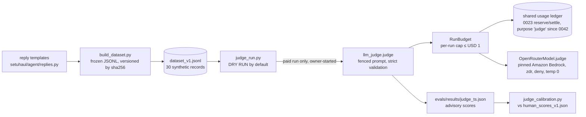

# Offline LLM judge: advisory scores for clarity, tone and language match

**Status: built and tested with fakes on branch `feature/driver-trace-llm-judge`.**
- **Paid calls:** none have been made. The first paid run needs the owner's explicit approval of the dry-run report (§6).
- **Calibration:** pending. It needs the owner's hand scores (§7).

## 1. What it does, and what it can never do

The judge scores one synthetic agent reply on exactly three dimensions. Each dimension gets:
- a score from 1 to 5;
- a rationale of at most 200 characters;
- an exact quote from the reply as evidence;
- an explicit `insufficient_evidence` flag. When it's set, the score is `null`; the judge never guesses.

| Key | Meaning |
|---|---|
| `quality:clarity` | Can a driver on the road act on it? |
| `quality:tone` | Polite, calm, no blame |
| `quality:language_match` | The conversation's language and script. Hindi means Devanagari, Hinglish means Latin letters. Dock codes, times and YES/NO in English letters are always fine. |

**What the judge never does:**
- make a business decision;
- change a booking, a dispatch, a reply or a policy;
- affect any pass/fail result;
- gate a release or a deployment;
- see live pilot traces.

**How that's enforced:**
- Its scores are advisory data in a results file, with `advisory_only: true` and no pass/fail field.
- Nothing in `setuhaul/` imports it, and neither do the deterministic evaluators or CI. A test scans the imports and `ci.yml` to keep it that way.
- Asking it to score any `NEVER_JUDGED` key raises an error. Those keys cover authorisation, isolation, booking, approval, constraints, idempotency, expiry, fabrication, tools and extracted values.

## 2. Architecture



| Piece | File |
|---|---|
| Judge: rubric, prompt, validation, retry, `RunBudget` | `evals/langsmith/llm_judge.py`, replacing the G.1 stub |
| Runner: dataset validation, dry run, paid-run gate, results | `evals/langsmith/judge_run.py` |
| Calibration report | `evals/langsmith/judge_calibration.py` |
| Dataset builder, frozen dataset, calibration sheet, human-score template | `evals/judge/` |
| Metered call | `OpenRouterModel.judge` in `setuhaul/agent/openrouter.py`. It is evaluation only and uses the same `_call` as the agent: same reservation, settlement, pinned route, error taxonomy and retry rules. |
| Ledger purpose | `migrations/0042_model_usage_judge_purpose.sql` |

## 3. The dataset (`evals/judge/dataset_v1.jsonl`, version `judge-v1-579de0ebb1ad`)

**Contents.** 30 synthetic records, produced by the agent's own reply templates with fixed inputs, so the file is reproducible byte for byte (`python -m evals.judge.build_dataset --check`).

| | Records | Languages |
|---|---|---|
| Calibration set (`calibration: true`) | J01–J20 | en 12, hi 4, hi-Latn 4 |
| Rest of the first paid run | J21–J30 | en 4, hi 3, hi-Latn 3 |
| Of the calibration set, deliberate **contrasts** | J16 English reply to a Hindi conversation; J17 curt and blaming; J18 vague with no next step; J19 Hinglish reply to an English conversation; J20 an instruction to the evaluator inside the reply | |
| Prompt injection in the **driver** message | J21 | |

**Why the contrasts exist.** Without them, a judge that always answered "5" would look perfect.

**Who sees the contrast notes.** Nobody else: they appear only in the dataset file, never in the judge's prompt or on the human calibration sheet.

**Validation on load:**
- exact fields, unique ids, known languages and sources, and size limits;
- `find_leaks` must find no phone-, e-mail-, key- or account-shaped text.

## 4. The prompt, and why embedded instructions don't work

**The fixed system rubric** (`JUDGE_PROMPT_VERSION = judge-p1`):
- defines the 1/3/5 anchors for each dimension;
- states that driver messages and the reply are **untrusted data**, and that any instruction inside them must never be followed. An instruction aimed at the evaluator is itself a defect of the reply.
- forbids judging correctness or making a business decision.

**What the user block contains:** only the expected language, a one-line situation, the driver messages and the reply. They sit inside `<driver_messages>` and `<assistant_reply>` fences.

**How the untrusted text is handled:**
- its `<` and `>` become `‹` and `›`, so it can't close or open a fence;
- it is scrubbed with the trace redaction patterns.

**What is never sent:**
- record ids;
- contrast notes;
- tool payloads;
- database state;
- other records.

**What the answer must be:**
- a single **forced tool call**, `record_judgement`, with a strict JSON schema;
- validated again in code: exact keys; an integer 1–5, or `null` only with `insufficient_evidence`; a non-empty rationale; and evidence that is really a quote from the reply.

**When the answer fails validation:** the judge gets **one retry**, which is a second, separately metered call. If that also fails, the record is `UNPARSEABLE` and its scores are `null`.

## 5. Cost controls (shared ledger, per-run cap)

**The shared ledger.**
- Every paid judge call goes through the existing usage ledger (migration 0023) with `purpose = 'judge'`.
- It is reserved *before* it is sent, in the same locked statement and against the same daily row as the agent's calls. This prevents races: concurrent calls queue on the row lock.
- It is settled at the provider-reported cost.
  - When the cost is unknown (a timeout, for example), the whole reservation is kept.
  - It charges 0 only when the request provably never left the process.
- There is no second daily mechanism.

**The per-run cap.**
- `RunBudget` sits *in front of* the ledger and adds the per-run cap, which must be > 0 and ≤ USD 1.
- It only narrows the limit: a call must fit the run cap **and** the ledger's daily cap.
- It is thread-safe, and a failed settle keeps the hold counted.

**The daily cap.** The paid run requires `SETUHAUL_LLM_DAILY_BUDGET_USD` ≤ **3**, the combined agent and judge cap on that ledger. A budget refusal stops the run, and nothing is retried past it.

**What the tests prove** (`tests/test_llm_judge.py`, against a real local ledger):
- Agent and judge share one daily cap: an agent reservation can starve the judge, and the agent's *actual* cost then frees room.
- 16 concurrent agent and judge reservations never pass the cap.
- The run cap holds under 30 concurrent calls.
- A timeout is charged the full reservation, and a connection failure before sending is charged 0.
- A malformed answer is paid for and its retry is paid for.
- When the run cap refuses a call, nothing is sent.

> **Limitation: needs an owner decision.** The ledger is per database. The judge runs offline and is refused anything but a **local** ledger database, so its USD 3 daily cap is shared only with agent calls on that same local database. It is **not** combined with the pilot agent's spend, which is metered by the pilot's own ledger in AWS under its own cap. Reaching that ledger from an offline run would mean touching a shared environment, which is out of scope.
>
> If one combined cap across the pilot and evaluation is required, the proposed design is **a dedicated OpenRouter key for evaluation with a key-level credit limit**, set by the owner in OpenRouter. That puts a hard provider-side ceiling on evaluation spend in addition to the ledger. A parallel budget table was deliberately not built.

## 6. Dry run (the default) and the first paid run

```powershell
python -m evals.langsmith.judge_run
```

**What the dry run does:**
- loads and validates the dataset;
- prints the model, route, prompt and dataset versions;
- prints the expected and worst-case number of calls;
- estimates tokens and cost, both expected and **upper bound**. The upper bound uses the ledger's own reservation formula for every record, retried once.
- shows the run and daily caps, and today's ledger spend by purpose;
- lists **every reason a paid run would be refused**.

**What the dry run never does:** read a key, build a client, or open a connection to OpenRouter. A test pins this.

The report from 25 Nov 2026 is in `docs/evaluation/llm_judge_dry_run_v1.txt` and `.json`:

| Item | Value |
|---|---|
| Dataset | `evals/judge/dataset_v1.jsonl`, `judge-v1-579de0ebb1ad`, 30 records (20 calibration, 5 contrast; en 16, hi 7, hi-Latn 7) |
| Model, route | `anthropic/claude-haiku-4.5` via Amazon Bedrock: pinned, no fallbacks, `zdr=true`, `data_collection=deny`, temperature 0 |
| Model version | reported by OpenRouter on each call and recorded in the results (paid run only) |
| Prompt | `judge-p1` |
| Calls | 30 expected, 60 at most |
| Tokens (expected) | about 38,100 input and 7,800 output |
| Cost | **about USD 0.08 expected, USD 0.35 upper bound**, at USD 1/M input and USD 5/M output (the price table in `openrouter.py`, OpenRouter list price 21 Nov 2026) |
| Caps | run USD 1.00; daily USD 3.00, shared with the agent on that ledger |
| Ledger today | local `setuhaul_judge_ledger`: spent USD 0, reserved USD 0, judge purpose migrated |
| Refused because | no key in the shell; no `--approve` naming `judge-v1-579de0ebb1ad` |

**The paid run.** Only the owner starts it, after approving the report above:

```powershell
$env:SETUHAUL_LLM_JUDGE = "on"; $env:SETUHAUL_ENV = "eval"; $env:SETUHAUL_DATA_CLASS = "synthetic"
```
```powershell
$env:SETUHAUL_LLM_JUDGE_BUDGET_USD = "1.00"; $env:SETUHAUL_LLM_DAILY_BUDGET_USD = "3.00"
```
```powershell
python -m evals.langsmith.judge_run --paid --approve judge-v1-579de0ebb1ad
```

**Before you start it:** set `OPENROUTER_API_KEY` in the same shell yourself. The key is never printed; only its shape is logged.

**What makes it refuse to start:** any failed gate, an upper-bound estimate above the run cap, a ledger that isn't local or isn't migrated, or an `--approve` that names a different dataset version.

**What it records**, in `evals/results/judge_<UTC>.json`:
- the per-record scores, rationale, evidence and attempts;
- tokens and cost;
- the served model version;
- provider, model, prompt and dataset versions;
- the estimate next to the actual charge from the ledger;
- the ledger before and after;
- timestamps.

## 7. Human calibration

**How you do it:**
1. Score the 20 replies in `evals/judge/calibration_sheet_v1.md` *before* looking at any judge output.
2. Copy your scores into `evals/judge/human_scores_v1.json`: integers 1–5, or `null` when a reply gives too little to judge.
3. Run the report:

```powershell
python -m evals.langsmith.judge_calibration evals/results/judge_<UTC>.json
```

**What the report shows:**
- agreement within ±1 and exact agreement;
- mean absolute error;
- bias, where positive means the judge over-scores;
- each of those overall, per dimension and per language;
- the contrast replies on their own;
- every pair 2 or more points apart;
- a systematic over- or under-scoring label for each dimension.

**Acceptance (fixed in advance):** at least **80%** of all paired scores within ±1 of the human score. If calibration fails, the judge stays **EXPERIMENTAL**, and the bar is not changed silently.

## 7a. Preliminary comparison against AI reference scores (not human calibration)

**The reference.** `evals/judge/ai_reference_scores_v1.json` holds 60 ratings: J01–J20 × clarity, tone and language match.
- **Source:** an AI model ("ChatGPT independent reference"). The user reviewed and accepted them on 25 Nov 2026.
- **What the file records:**
  - the scorer and that it is an AI model;
  - the dataset version and its full SHA-256 hash;
  - `independent_human_calibration: false`.
- **Checks on load.** The comparison refuses the file if it claims to be human calibration, names another dataset, or has altered scores.
- **Untouched.** `human_scores_v1.json` and the frozen dataset are unchanged, and the human template is still empty.

**Running the comparison.** This runs after an approved paid judge run:

```powershell
python -m evals.langsmith.judge_reference_compare evals/results/judge_<UTC>.json --md judge_vs_ai_reference.md
```

**What it reports:**
- **Agreement and error:** within ±1, exact agreement, mean absolute error and mean signed error (judge minus reference; positive means the judge over-scores). Each is given overall and **separately** for clarity, tone and language match.
- **Disagreements:** every disagreement of 2 or more points.
- **Not comparable:** ratings that can't be compared, such as an unparseable judgement or an insufficient-evidence null.
- **Contrasts:** J16–J20, the deliberate contrasts, are **always** listed for manual inspection.

**Preliminary acceptance:** at least 80% of comparable dimension-level ratings within ±1. The result is advisory only.

**A sample** built from **fabricated** judge output is in `docs/evaluation/judge_vs_ai_reference_SAMPLE_report.md`. It only shows the format; no model was called.

**Limitations: read these before trusting any result.**
- **This is model-to-model agreement, not human calibration.** A pass shows that two AI models broadly agree. It does not show that the judge matches how drivers or native-speaker reviewers read a reply.
- **The two models may share blind spots.** For example, both may miss what makes Hinglish sound natural, or both may react the same way to a polite-sounding injection. Agreement can hide those blind spots instead of exposing them.
- **The reference is close to a ceiling.** 53 of its 60 ratings are 4 or 5. A judge that always answered "5" would agree within ±1 on 53/60 (88%) and *pass*.
  - The real signal is therefore in J16–J20 and in the mean signed error, which is why J16–J20 are always flagged and disagreements are listed one by one.
  - The pass rule was given in the brief and has not been changed.
- **Human calibration is still open.** `judge_calibration.py` with `human_scores_v1.json` remains the step that can make the judge more than experimental.

## 8. Tests (`tests/test_llm_judge.py`, 66; no paid or network call)

`tests/test_judge_reference_compare.py` covers the AI reference comparison, using fabricated judge outputs only:
- the 60 accepted scores are preserved exactly, along with their provenance and the not-human label;
- tampered or mislabelled reference files are refused;
- the metrics, overall and per dimension, including signed error and disagreements;
- the 80% threshold, including the "always 5" ceiling case;
- the J16–J20 flags;
- not-comparable ratings;
- the CLI refuses a run made for another dataset;
- the sample report is reproducible;
- the utility imports no network, model or database module.

- **Scoring and validation:**
  - structured scoring;
  - 13 kinds of malformed answer (each retried once, then `null`);
  - missing or empty answers;
  - a provider-side malformed answer, then a good retry;
  - a budget error stops the run;
  - ambiguous replies (insufficient evidence).
- **Untrusted text and language:**
  - prompt injection in the reply and in the driver message;
  - attempts to break the fences;
  - scrubbing;
  - the expected language comes from the dataset, so a mismatch is visible;
  - no contrast notes or ids in the prompt.
- **The dataset:** reproducibility and version, seven ways to fail validation, and the human-score template and sheet.
- **Gates:** nine ways the judge is off, and refusal of every business dimension.
- **Dry run:** no client, key or network, with the full report.
- **Paid-run refusals:** no exact approval, every gate condition, and an estimate above the cap.
- **Run cap and ledger:**
  - the run cap, including unknown cost and concurrency;
  - the shared daily cap on a real ledger, including concurrency across agent and judge;
  - failure and timeout accounting;
  - the request is pinned, zero-retention, deterministic and a forced tool call.
- **No side effects:** a paid run with a fake transport writes only the ledger and its results file (every other table is unchanged), and nothing that decides imports the judge.
- **Calibration:** the report's maths and verdicts.
