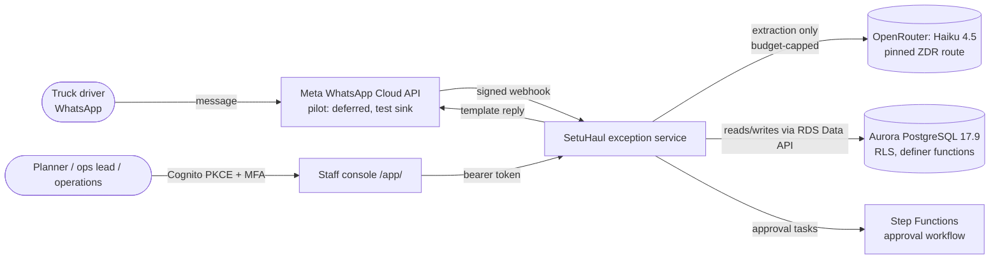
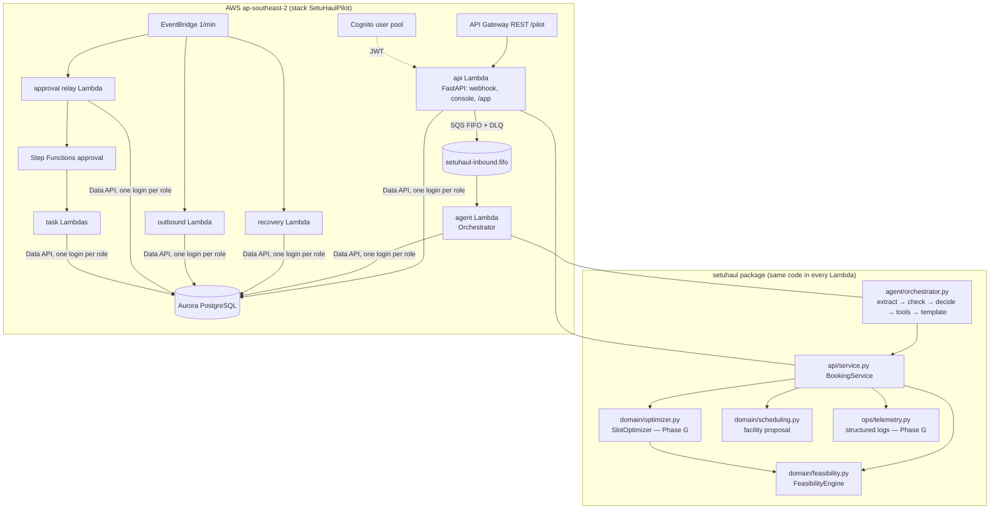
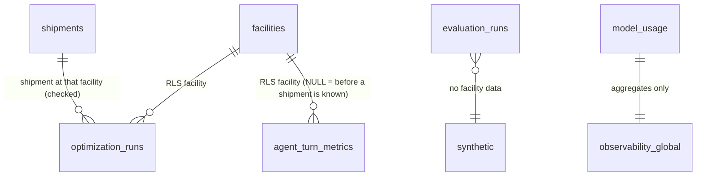

# Phase G architecture

Phase G adds a deterministic optimizer, an evaluation suite and observability to the existing system. It changes no
booking rule, approval policy, IAM grant or deployment. The deployed synthetic pilot (`v0.2.1`, `release/fde-sydney-pilot`)
is untouched; nothing here is deployed.

## HLD L1: context

The model only extracts structured facts from the driver's words. Options come from the feasibility engine and the
Phase G optimizer; bookings are decided by PostgreSQL functions; people decide what the policy sends to people.

## HLD L2: components (as deployed, plus Phase G)

| Component | Role in Phase G | Database role (login) |
|---|---|---|
| `SlotOptimizer` (`setuhaul/domain/optimizer.py`) | Ranks one truck's options; HC01–HC12; structured result | none (pure) |
| `BookingService._rank_with_optimizer` | Driver path, only when `SETUHAUL_OPTIMIZER_RANKING=on` | feasibility (read view, record run) |
| `BookingService.recommend` | `GET /console/shipments/{id}/recommendations` | console (read view in the person's scope, record run) |
| `BookingService.observability` | `GET /console/observability` | console (RLS-scoped reads, `observability_global()`) |
| `BookingService.record_turn_metrics` | One `agent_turn_metrics` row per finished turn | feasibility |
| `evals/phase_g/run_eval.py` | G2 suite; `record_evaluation_run` | system (local only) |
| `perf/serve_local.py`, `perf/locustfile.py` | G7 load test, local only | local superuser for setup; roles as above at run time |

**Why the console reads with the console role.** The pilot's api function has only the `ingest` and `console` logins
(`infra/setuhaul_stack.py` `WORKLOAD_ROLES`). The console Confirm HTTP 500 (failure F5) came from a code path that needed
a login the api does not have. The recommendation and observability routes therefore use only the console role, and the
facility scope comes from the verified token through RLS.

## Data (migration 0027, additive)

| Object | Kind | Writers | Readers | RLS |
|---|---|---|---|---|
| `optimization_runs` | table, append-only | `record_optimization_run` (feasibility, console) | console, system | forced, by facility |
| `agent_turn_metrics` | table, append-only | `record_agent_turn` (feasibility) | console, system | forced, by facility |
| `evaluation_runs` | table, append-only | `record_evaluation_run` (system) | console, system | listed with reason (no facility data) |
| `observability_global(since)` | read-only definer | — | console, system | aggregates `model_usage`, `idempotency_keys`, `approval_callbacks` (no facility column) |

All definers are owned by `setuhaul_rpc` (NOBYPASSRLS) with `search_path = setuhaul, pg_catalog, pg_temp`; `EXECUTE` is
revoked from PUBLIC. The agent role gains nothing (`tests/test_agent_not_operator.py`). Every function returns `uuid`
or `jsonb`, which the RDS Data API carries.

## Switches

| Switch | Default | Effect |
|---|---|---|
| `SETUHAUL_OPTIMIZER_RANKING` | `off` | `on`: the driver's options are the optimizer's ranked, re-proven set (labour, capacity, soft objectives). Off: the engine's order, as in `v0.2.1`. Which slots a driver sees first is booking policy, so the owner turns it on per environment. |
| `phase_g_assumptions.json` | see file | Labour crews per shift, facility capacity, staleness and time limits for the dataset and the optimizer. |
