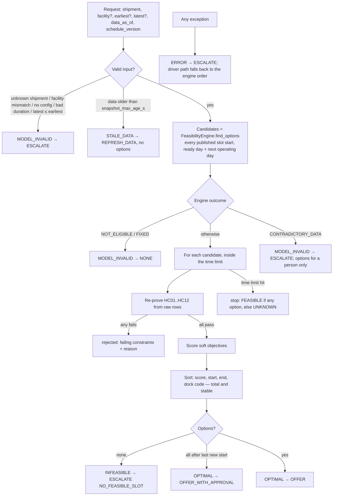

# Phase G1: optimization design

Code: `setuhaul/domain/optimizer.py` (`SlotOptimizer`, `OptimizerConfig`, `Weights`). Tests: `tests/test_optimizer.py`
(pure) and `tests/test_phase_g.py` (PostgreSQL, also in Data API mode).

## 1. Problem

For ONE truck (arriving, early, late or delayed), choose and rank dock + start time options at its destination facility.
The facility-wide sequencing of all trucks is a different problem and stays in `setuhaul/domain/scheduling.py`
(Phase F, dispatch rules); multi-facility optimization is out of scope.

## 2. Decision flow

## 3. Solver choice: exhaustive enumeration, not CP-SAT

| Criterion | OR-Tools CP-SAT | Exhaustive enumeration (chosen) |
|---|---|---|
| Problem size per truck | docks × slot starts ≈ 9 × 32 ≈ 300 candidates | same |
| Optimality | proven optimal | exact over the same finite set (every candidate evaluated) → `OPTIMAL` |
| Lambda zip / build | `ortools` wheel ≈ 30 MB + protobuf; manylinux cp313 wheel must be pinned; changes the reproducible `build/lambda.zip` and the deployment manifest hash | no dependency |
| Determinism | needs `num_workers=1`, fixed seed, and still version-sensitive | pure Python, integer scores, total tie-break |
| Explainability | objective value; reasons need extra work | per-term scores and reasons per option |
| Time limit | native | `time_limit_ms` checked before each candidate |

The Frame spike (`docs/1-frame/solver_results.md`) reached the same conclusion for the larger facility problem. CP-SAT
would become worth it for joint multi-truck re-sequencing with labour as a cumulative resource across a day; that is
out of scope (autonomous rescheduling, multi-facility optimization).

Reproducibility record: solver `exhaustive-enumeration` `1.0.0`, engine `slot-optimizer-v1`, seed `0` (no randomness),
default time limit 2 000 ms, weights below. Every result carries them (`config`) and a SHA-256 `input_fingerprint` of
the candidates, the claims, the request and the configuration.

## 4. Hard constraints (never violated by a returned option)

| Id | Constraint | How it is proven (re-derived from rows, independent of the engine's verdict) |
|---|---|---|
| HC01 | Dock in the facility | `docks.facility_id` = shipment destination = request facility |
| HC02 | Dock operational | no BREAKDOWN event overlapping; every slot in the run `OPEN` |
| HC03 | Compatible with cargo and vehicle | `FeasibilityEngine.dock_compatible` (type, weight limit, refrigeration; heavy threshold per facility) |
| HC04 | Inside operating hours | facility `open_time` ≤ start and end ≤ `close_time` on that day |
| HC05 | No maintenance window | no MAINTENANCE / MANUAL_BLOCK event overlapping |
| HC06 | No overlap with an active claim | every active `dock_occupancy` claim on that dock (confirmed, pending, holds, trucks in dock) |
| HC07 | Labour available | crews rostered (`facility_config.shifts[*].crews`, or config) at every 15-minute point of the slot > peak concurrent claims at the facility |
| HC08 | Duration sufficient | end − start ≥ expected unload + changeover |
| HC09 | Arrival compatible | start ≥ ready (fused ETA + confidence band + gate-to-dock, or gate-in) and inside the driver's earliest/latest |
| HC10 | Facility capacity | peak concurrent unloads + 1 ≤ capacity (config; default = dock count) |
| HC11 | Confirmed bookings respected | a second source: the `appointments` rows (CONFIRMED / IN_PROGRESS) of other shipments on that dock |
| HC12 | No other facility's data | dock, every slot and every claim counted belong to the facility |

Tests assert the property three ways: the optimizer's own validator (`validate_options`), an **independent oracle**
in the test file, and a seeded random fuzz (150 worlds × 3 trucks, labour/capacity/events varied) plus the trainer
snapshot (21 shipments × 8 clock times × 3 windows).

## 5. Soft objectives and weights (lower is better, integers)

| Term | Formula | Default weight | Why |
|---|---|---|---|
| wait | `wait_per_min × w × f × (start − ready)` | 3 | yard time; `w` = priority (CRITICAL 8, HIGH 4, NORMAL 2, LOW 1); `f` = 2 for temperature-controlled (perishable) cargo |
| gap | `gap_per_min × (start − fused ETA)` | 1 | what the driver experiences from arrival |
| disruption | `change_penalty + shift_per_min × |Δstart|` if the dock changes or the start moves > 15 min from a confirmed appointment | 60 + 1/min | minimal rescheduling: a told time is costly to change |
| labour idle | `idle_per_min × gap after the previous claim on that dock` (cap 120) | 1 | pack work, fewer idle crew minutes |
| overtime | `overtime_per_min × minutes after the last new start time` | 5 | after-hours work needs approval |
| utilisation | `utilisation_per_pct × % of that dock's day already booked` | 1 | spread load |
| bottleneck | `bottleneck_penalty` if this truck brings the facility to its capacity | 40 | keep headroom for late trucks |

Not lexicographic: a weighted sum, chosen so that for a NORMAL truck one hour of extra waiting (360) outweighs moving a
promise (≈ 60 + minutes) and any utilisation difference (≤ 100), while perishable CRITICAL cargo (`w × f` = 16) makes
waiting dominate everything else (test `test_perishable_time_critical_cargo_prefers_the_earliest_slot`). Tie-break:
score, start, end, dock code.

## 6. Output (structured, never free text)

`OptimizationResult.to_dict()`: `request_id`, `facility_id`, `shipment_id`, `input_eta`, `ready_at`, ranked `options`
(`rank`, `dock_id`, `dock_code`, `start`, `end`, `wait_min`, `gap_min`, `duration_min`, `needs_approval`, `feasible`,
`score`, `score_terms`, `reasons`), `rejected` (stage `feasibility` / `hard_constraints` / `ranking`, with the failing
constraints), `constraints_evaluated` (HC01–HC12), `solver`, `solver_version`, `engine_version`, `solver_status`,
`outcome_code`, `recommended_action`, `warnings`, `candidates_evaluated`, `duration_ms`, `data_as_of`,
`schedule_version`, `input_fingerprint`, `config`, `not_a_booking: true`.

## 7. Safe outcomes

| Situation | Status | Action | Driver path |
|---|---|---|---|
| No feasible slot | INFEASIBLE | ESCALATE | durable NO_FEASIBLE_SLOT escalation |
| Unknown shipment, facility mismatch, no configuration, unload ≤ 0, latest ≤ earliest | MODEL_INVALID | ESCALATE | escalation / ask |
| Double-assigned driver or vehicle | MODEL_INVALID (CONTRADICTORY_DATA) | ESCALATE | options to a person only |
| Facility data older than `snapshot_max_age_s` | STALE_DATA | REFRESH_DATA | engine options (fallback) |
| ETA evidence older than `eta_stale_after_min` | as computed + `ETA_STALE` warning | as computed | as computed |
| Time limit reached | FEASIBLE (some proven) / UNKNOWN (none) | OFFER / ESCALATE | proven options only; UNKNOWN → engine fallback |
| Exception inside the optimizer | ERROR | ESCALATE | engine options, `fallback_used = true` |

## 8. Boundaries

The optimizer is pure: no database, network, model or clock beyond the injected `perf_counter`. It never commits a
booking. In the driver path its options are published as ordinary `shown_options` and every later step (select,
read-back, attested YES, hold, submit, approval) is unchanged; the database re-proves everything under its locks, so
two drivers recommended the same slot cannot both get it (`test_two_drivers_racing_for_the_same_recommended_slot_one_wins`).
The language model never sees or changes the options: replies are deterministic templates (owner decision OD-3).

## 9. Examples (trainer dataset, 4 Aug, from `run_optimizer_snapshot` rows O01–O09)

| Shipment, clock | Status / outcome | Top options | Note |
|---|---|---|---|
| SHP1009 09:50 | OPTIMAL / OPTIONS | D4 12:00, D1 13:00, D2 13:00 | D3 12:00 rejected: blocked slot (leveller breakdown) |
| SHP1015 16:26 | INFEASIBLE / NO_FEASIBLE_SLOT | — | reefer load, reefer dock taken: worked example, escalates |
| SHP1014 09:52 | OPTIMAL / OPTIONS | D4 13:00, D2 13:00, D4 14:00 | 21 t never on D1 (20 t limit) |
| SHP1010 09:35 | OPTIMAL / OPTIONS | D5 12:00, 13:00, 14:00 | reefer dock only |
| SHP1003 09:35 | MODEL_INVALID / CONTRADICTORY_DATA | (for a person) | driver double-assigned in the trainer data |
