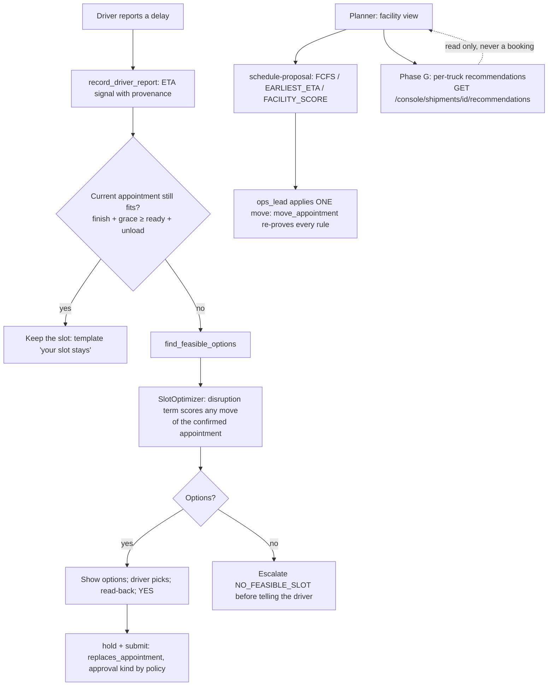
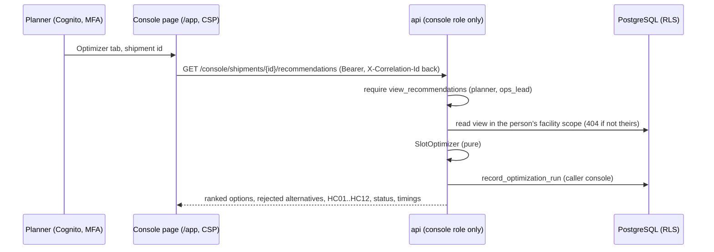

# Phase G workflows

All flows below are the code paths in `setuhaul/agent/orchestrator.py`, `setuhaul/api/service.py` and the database
functions. The model appears in one box only (extraction). Nothing in Phase G adds a way to book.

## 1. Driver booking flow (with the optimizer ranking switched on)

```mermaid
sequenceDiagram
  autonumber
  participant D as Driver (WhatsApp)
  participant A as api Lambda (webhook)
  participant Q as SQS FIFO
  participant O as Orchestrator (agent Lambda)
  participant M as Model (extract only)
  participant S as BookingService
  participant X as SlotOptimizer
  participant DB as PostgreSQL
  D->>A: "Traffic, reaching by 4:30 pm"
  A->>DB: ingest (ingest role): message, receipt
  A->>Q: event (group = driver)
  Q->>O: one turn (lease + fence, correlation id)
  O->>M: extract structured facts
  M-->>O: intent, ETA, window (or rules reader on failure)
  O->>S: record_driver_report (provenance: this driver's message)
  O->>S: find_feasible_options
  S->>DB: read view (feasibility role, read only)
  S->>X: optimize(shipment, window)
  X-->>S: ranked options, HC01..HC12 proven, status OPTIMAL
  S->>DB: record_optimization_run; publish shown_options (5-min expiry)
  O-->>D: template: numbered options
  D->>O: "1"  → select_option → database read-back
  D->>O: "haan ji"  → ingest attests YES → hold_option → submit_booking_request
  S->>DB: hold/submit re-check every rule under locks (exclusion constraint)
  DB-->>O: PENDING (approval workflow) or CONFIRMED (policy)
  O->>DB: record_agent_turn (tools, statuses, latencies; no text)
```

With the switch off (the `v0.2.1` default) step 11 is skipped and the engine's own order is published.

## 2. Delayed truck and rescheduling flow



Autonomous rescheduling is out of scope: a move of a confirmed promise is always a person's action (`move_appointment`,
ops_lead) or the driver's own confirmed request.

## 3. Failure and recovery flow

```mermaid
flowchart TD
  w[Webhook] -->|not stored| r503[503: provider retries]
  w -->|stored, publish failed| rs[recovery Lambda re-publishes unpublished receipts]
  q[SQS FIFO] -->|turn crashed| rd[redelivery: new generation, old worker fenced]
  rd -->|max receives| dlq[(DLQ) → operator redrive procedure]
  t[Turn] -->|model error / budget| rules[rules reader + templates]
  t -->|optimizer ERROR / UNKNOWN / STALE| eng[engine's own options, fallback_used = true]
  t -->|NO_FEASIBLE_SLOT / CONTRADICTORY_DATA| esc[durable escalation, then 'a coordinator will…']
  t -->|escalation insert failed| noprom[no coordinator promise]
  t -->|pick after offer expired| fresh[Phase G: 'slots expired' + fresh options]
  b[Booking] -->|kill switch engaged| ref[database refuses new commitments]
  b -->|two drivers, same slot| one[exclusion constraint: exactly one wins]
  ap[Approval] -->|Step Functions task failed| redrive[safe redrive; ApprovalFailed alarm]
```

## 4. Planner view of a recommendation (console)


