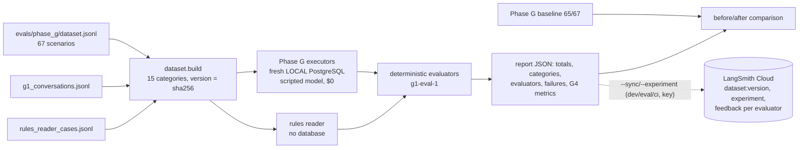
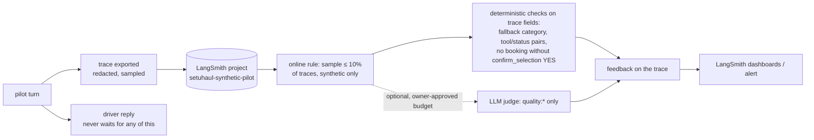

# LangSmith evaluation (G2)

Status: implemented; the offline evaluation was run locally ($0, scripted model). **The LangSmith sync was not run**
(no key; an external upload of datasets is an owner decision). Results: see §7 and PHASE_G1_FINAL_VALIDATION_REPORT.md.

## 1. What is kept

The Phase G framework (`evals/phase_g/run_eval.py`) and its 67 scenarios are unchanged in content. Baseline: **65 pass
/ 2 fail (I14, I15)** (`evals/results/phase_g_eval_20261123_1024.json`, code `2051241`). The runner keeps its
local-only restriction: a fresh local PostgreSQL database (`local_env.assert_local`). The G.1 entry point additionally
refuses `SETUHAUL_DSN=rds-data` and `SETUHAUL_ENV=pilot/staging`. The runner has no pilot database access.
One runner change: a conversation row may inject a **named** failure category (`"x": "MODEL_ERROR:EMPTY_SECRET"`)
and assert `fallback_reason`. Existing rows behave as before.

## 2. Datasets (15 categories)

`evals/langsmith/dataset.py` builds one dataset, `setuhaul-g1-agent-eval:<version>`, from three repository files (nothing
invented):

| Source | Rows | Role |
|---|---|---|
| `evals/phase_g/dataset.jsonl` | 67 | the Phase G scenarios, each mapped to ONE primary category; the original category and extra tags kept in metadata |
| `evals/langsmith/g1_conversations.jsonl` | 7 | thin categories: fallback per failure category (F01–F04), expired slots (X01–X02), idempotency (P01) |
| `evals/langsmith/rules_reader_cases.jsonl` | 37 | G4 regression: deadlines, arrivals, negatives, ETA/delay, Hinglish, English preservation |

Categories: intent, tool_selection, parameter_extraction, eta_delay, deadline, arrival, optimization, booking, approval,
authn_authz, cross_facility_isolation, idempotency, expired_slots, hindi_hinglish, model_unavailable_fallback.

Each example: `inputs`, `outputs.expected` (the expected behaviour), `metadata` (source id, title, original category,
kind, tags, `synthetic: true`, `baseline_known_failure`), `category`, `assertions` (the evaluator names that judge it).
**Versioning**: the dataset version is `g1-` + the first 12 hex of SHA-256 over the canonical JSON of all examples, so
it is deterministic and changes with any edit. Evaluators carry `EVALUATOR_VERSION` (`g1-eval-1`). Both are stored with
every report and in every LangSmith example and experiment.

## 3. Deterministic evaluators (authoritative)

`evals/langsmith/evaluators.py`. Each reads what the run actually did (the runner's checks against stored state and HTTP
answers, or the rules reader's output) and scores 1 / 0 / not applicable:

| Evaluator | Judges |
|---|---|
| tool_selection | required tools called, forbidden tools not called, decision path |
| parameters, eta, deadline | extracted values (`param:*`), arrival time/delay, completion deadline and its kind |
| intent, arrival | intent (incl. negative "must not be"), arrival recognised exactly when it should be |
| optimizer_invoked | the optimizer ran, its top option was shown, or it fell back with options still shown |
| hard_constraints | the 12 hard constraints re-proved on every offered option; dock exclusions |
| no_unauthorized_booking | no appointment/hold unless authorised; hold/submit never called when forbidden |
| no_fabricated_confirmation | an invented yes, option or dock never changes state |
| approval_required | approval-boundary calls refused with the expected status |
| authorization | authentication/role answers; no phone in replies or answers |
| no_cross_facility_leak | another facility's data absent; cross-facility calls refused |
| idempotency | a repeated call answers the same and has one effect |
| expired_offers | an expired pick gets fresh slots, never "did not understand", never a booking |
| fallback | rules reader used with the expected category; options still offered |

## 4. LLM-as-judge (subjective only, off)

`evals/langsmith/llm_judge.py` defines the only allowed judge keys (`quality:clarity`, `quality:tone`,
`quality:language_match`) and the list it may never judge (authorisation, isolation, booking, approval, constraints,
idempotency, expiry, fabrication, tools, extracted values). It raises unless `SETUHAUL_LLM_JUDGE=on`, the environment is
dev/eval and an owner-approved budget is set. Even then G.1 ships no model call (paid calls need approval). A judge
score never changes PASS/FAIL.

## 5. Running it

```
python -m evals.langsmith.run --manifest        # dataset version and counts, no run
python -m evals.langsmith.run --skip-phase-g    # rules-reader cases only (no database), seconds
python -m evals.langsmith.run                   # everything, local DB, $0; compares to the Phase G baseline
python -m evals.langsmith.run --compare <before.json>        # before/after on the 67 rows
SETUHAUL_ENV=dev LANGSMITH_API_KEY=… python -m evals.langsmith.run --sync --experiment   # NOT run in G.1
```

Output: `evals/results/g1_langsmith_eval_<stamp>.json` with totals, per-category and per-evaluator results, a
**failure inspection** list (id, category, failing evaluators, reason), the rules-reader metrics, and the comparison
(newly passing / newly failing / missing rows). `--sync` creates the dataset once per version (`GET /datasets?name=` →
`POST /datasets` + `POST /examples/bulk`). `--experiment` creates an experiment session referencing it and posts one run
per example plus one feedback score per evaluator.



## 6. Online evaluation (design only, not built)



* Sampling: deterministic checks on 100% of traces are free (they read trace fields). An LLM judge, if ever approved,
  samples ≤ 10% with a daily cap set by the owner.
* Privacy: only redacted traces exist; content stays off; synthetic data only. A judge sees what the trace holds and
  nothing else.
* Cost and retention: LangSmith plan limits (traces/month, retention days) are an owner decision. Recommendation:
  shortest retention on the pilot project, and longer only for curated datasets.
* Never blocking: online evaluation runs in LangSmith after export. The driver's reply is stored before export
  begins, so evaluation can never delay or change a conversation.

## 7. Results

Final validation run, 23 Nov 2026, local, $0 (`evals/results/g1_langsmith_eval_20261123_1426.json`):

* Dataset `g1-710318ed7e5e`, evaluators `g1-eval-1`: **111 / 111 examples pass**, all 15 categories at 100 %, no failing
  evaluator, failure inspection list empty.
* Phase G 67 scenarios: **67 / 67** (baseline 65 / 67). Newly passing **I14, I15**; newly failing none; missing none.
* Rules reader: intent 37/37, deadline 12/12, arrival 20/20, false-positive delay 0/17.
* LangSmith sync / experiment: not run (no key; owner decision). The LLM judge is off.

Per-category and per-evaluator tables: PHASE_G1_FINAL_VALIDATION_REPORT.md §3.
