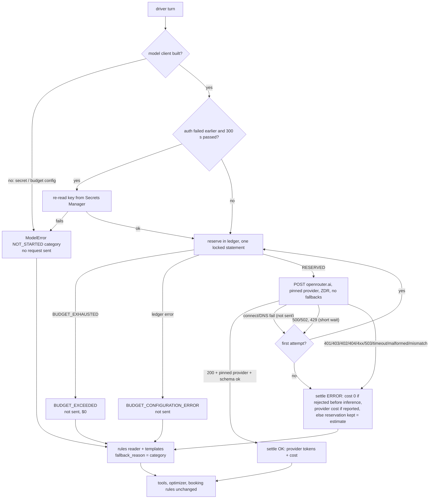

# OpenRouter on the AWS pilot: diagnosis, fixes, operator steps (G3)

Status: **diagnosed from evidence; code fixes implemented and tested locally; NOT deployed.** No secret was read, changed or
rotated. No model call was made. AWS account ids are masked (`************`).

## 1. What the console showed (23 Nov 2026, last 24 h)

35 model calls: 0 successful, 27 errors, 8 refused by the daily budget, 0 tokens, $0; the rules reader handled every
message. The working hypothesis was "the `setuhaul/pilot/openrouter` secret is empty (CDK creates it empty)".

## 2. Evidence gathered (read-only)

| # | Source (read-only call) | Observation |
|---|---|---|
| E1 | `cdk.out/SetuHaulPilot.template.json` | `OpenRouterKey…`: `"GenerateSecretString": {}` and no `SecretString`. CloudFormation therefore **generated a random 32-character password** as the value. |
| E2 | `secretsmanager:DescribeSecret`, `ListSecretVersionIds` (metadata only) | One version, `AWSCURRENT`, created 22 Nov 11:59:22 UTC together with the secret; `LastChangedDate` = creation; KMS-encrypted with the stack key; `LastAccessedDate` 23 Nov. **The value has never been changed since CloudFormation generated it.** |
| E3 | `logs:FilterLogEvents`, agent log group, 7 days | `model_call … requested=amazon-bedrock actual=None status=401 category=auth latency_ms=14–17 cost=0`, then `ALERT model_call auth: OpenRouter refused the key or its credit (status 401)`, for every attempt on 22 and 23 Nov. |
| E4 | RDS Data API, `system` login, `SET TRANSACTION READ ONLY`: `model_usage` grouped | 22 Nov: 8 × `ERROR/auth` (cost 0, `provider`), 9 × `BUDGET_EXHAUSTED` (cost 0, `not_sent`). 23 Nov: 19 × `ERROR/auth`. Tokens NULL on every row. |
| E5 | same, `model_budget_day` | 22 Nov: `spent_usd 0.250000` (= the cap), `reserved_usd 0`, label `pilot-ap-southeast-2`. 23 Nov: spent 0, reserved 0, label `pilot`. |
| E6 | `scripts/e2e_aws.py` | **A5** "model unavailable (OpenRouter refuses the key)" expects the 401. **A6** inserts the day row with label `pilot-ap-southeast-2` and sets `spent_usd = greatest(spent_usd, 0.25)` for the current UTC day. |
| E7 | `lambda:GetFunctionConfiguration` (values masked) | Agent: `SETUHAUL_ENV=pilot`, `SETUHAUL_MODEL_PROVIDER=openrouter`, model `anthropic/claude-haiku-4.5`, pinned provider `amazon-bedrock`, budget `0.25`, secret id present. Not in a VPC (public egress). |
| E8 | Code: `lambdas._orchestrator` → `model_for` → `load_openrouter_key` at cold start | An empty or unreadable secret **raises at cold start** and every turn fails. Turns did not fail; they fell back after a 401. So the value was read and parsed, non-empty, passed as `Authorization: Bearer …`. |

## 3. Root causes

### RC1: 27 errors (`PROVIDER_AUTH_ERROR`). Configuration, not code

The secret is **not empty**. It holds the random placeholder CloudFormation generated, which OpenRouter rejects with
401 before any inference (so $0, no tokens: correct accounting). The owner step "put the OpenRouter key in
`setuhaul/pilot/openrouter`" was never done. Everything else in the chain works, and E3, E7 and E8 rule each item out:

| Check | Result | Evidence |
|---|---|---|
| secret exists, right region | yes, ap-southeast-2 | E2 |
| populated | yes, with a CloudFormation placeholder, not an OpenRouter key | E1, E2 |
| Lambda role has `GetSecretValue` (+ KMS decrypt) | yes | E2 `LastAccessedDate`, E8 |
| latest version retrieved, parsed | yes (`AWSCURRENT`, plain string) | E2, E8 |
| stale cache | not the cause today (the value never changed); a real gap for later, see C3 | E2 |
| key passed to the client | yes, as the Bearer header | E3 (OpenRouter answered 401, not 400) |
| DNS / egress / TLS / endpoint | working | E3: an HTTP status in 15 ms |
| model id, payload, parameters | not reached: auth fails first | E3 |
| fallback | worked: rules reader every time, never another paid model | E3, logs |

### RC2: 8 refusals at $0. Residue of the deliberate drill A6, not a budget defect

A6 set the 22 Nov (UTC) counter to the cap and did not give it back. Every later reservation that UTC day was refused.
The console's "last 24 hours" on 23 Nov still covered the end of 22 Nov UTC (the budget day rolls at 00:00 UTC =
05:30 IST). Budget mechanics checked against the brief:

| Item | Finding |
|---|---|
| config | `SETUHAUL_LLM_DAILY_BUDGET_USD=0.25`, parsed as Decimal, must be > 0 |
| counters, persistence | `model_budget_day` per UTC day; one locked UPDATE checks and reserves; `model_usage` row per attempt |
| daily reset | UTC calendar day (unchanged; documented in the console now) |
| initialization | the day row is inserted on first use (`ON CONFLICT DO NOTHING`) |
| pre-request estimate | `(len(body)/3 × input price + max_tokens × output price) × 1.2`, at least $0.001 |
| reservation / release | settle moves the reservation into spent: the provider cost, 0 if never sent / rejected before inference, the whole reservation if unknown. E5: `reserved_usd = 0`, so nothing leaked |
| failure accounting | 401 charged 0 (`provider`), refusals 0 (`not_sent`) |
| concurrency | the cap check and the reservation are one statement under a row lock; tested (20 threads, never over the cap) |

The budget was **not** raised, bypassed or reset in this phase.

### Contributing code gaps (fixed, see §4)

* C1: categories too coarse (`auth`, `config`) to tell an empty secret, a denied read, a placeholder and a provider refusal apart;
* C2: a missing, empty or unreadable secret at cold start failed **every** turn instead of degrading;
* C3: the key was cached for the container's life, so a key set later is ignored until containers recycle;
* C4: a failed call's trace said `0` tokens (the ledger correctly said NULL);
* C5: secret error messages included the secret **ARN**, which carries the account id;
* C6: the drill A6 left the day spent;
* C7: the console could not show refusals vs errors vs never-started, or estimated vs provider cost.

## 4. What changed in code (implemented, tested locally, not deployed)

| Gap | Change | Where | Tests |
|---|---|---|---|
| C1 | 16 structured categories; old names kept as `detail` | `setuhaul/agent/errors.py`, `openrouter.py`, `models.py` | `test_phase_g1.py` (taxonomy, HTTP, transport, secrets); `test_providers.py` now asserts category **and** detail |
| C2 | `DeferredModel`: secret/budget-configuration failures degrade to the rules reader with the category recorded ("never started") and retry building at most every 300 s; a refused environment, data class or model is still fatal | `models.py`, `aws/lambdas.py` | `test_a_secret_problem_degrades…`, `test_a_never_started_model…` |
| C3 | After `PROVIDER_AUTH_ERROR`, the key is re-read before the **next** call, at most once per 300 s; the failed call is never repeated | `openrouter.py` | `test_after_a_401_the_key_is_re_read…`, `test_a_failed_re_read…` |
| C4 | `Trace` tokens default `None`; only provider-reported usage is copied | `models.py`, `openrouter.py` | `test_a_failed_call_reports_no_tokens…`, updated `test_malformed_usage_metadata…` |
| C5 | Secret errors name the category and exception class only | `openrouter.py`, `observability/langsmith.py` | `test_secret_problems_are_classified_and_never_reveal…` |
| C6 | A6 gives back exactly what it seeded (`spent − seeded`, never real spend) | `scripts/e2e_aws.py` | reviewed; not run (it writes to the pilot) |
| C7 | Migration 0028 `observability_model_detail()` + console split and reconciliation | `migrations/0028…`, `api/service.py`, console | `test_refusals_errors_and_estimates…`, `test_model_outcome_status…` |
| shape | cold start logs `key shape=openrouter_format/unrecognized_format` (never the value) and alerts on a non-OpenRouter shape | `openrouter.py` | `test_the_key_shape_is_described…` |

The CDK `OpenRouterKey` resource is deliberately **unchanged**. Editing `GenerateSecretString` would make CloudFormation
replace the value on the next deploy, possibly overwriting the real key once the owner sets it. `tests/test_infra.py`
pins it.

## 5. Error categories and console outcome classes

| Category | Class | Typical cause | Retried? |
|---|---|---|---|
| MISSING_SECRET | never started | secret id not configured, `ResourceNotFoundException` | no (client rebuilt ≤ every 300 s) |
| EMPTY_SECRET | never started | empty string or `{"api_key": ""}` | same |
| SECRET_ACCESS_DENIED | never started | IAM `AccessDenied`, KMS `DecryptionFailure` | same |
| SECRET_RETRIEVAL_ERROR | never started | other Secrets Manager failure, binary or bad JSON | same |
| BUDGET_CONFIGURATION_ERROR | never started | no ledger, bad cap, ledger unavailable, duplicate reservation | no |
| BUDGET_EXCEEDED | budget refusal | the day's cap reached (no request sent) | no |
| NETWORK_ERROR | provider failure | connect refused / connect timeout / transport | once, only if not sent |
| DNS_ERROR | provider failure | name resolution | once (not sent) |
| TLS_ERROR | provider failure | certificate/handshake | no |
| PROVIDER_AUTH_ERROR | provider failure | 401/403, 402 or a spent-limit 403 (detail `credits`) | no; key re-read before the next call |
| PROVIDER_RATE_LIMIT | provider failure | 429 | once if Retry-After ≤ 2 s |
| PROVIDER_SERVER_ERROR | provider failure | 500/502 (retried once), 503 pinned route unavailable (never re-routed) | 500/502 once |
| MODEL_NOT_FOUND | provider failure | 404, or a 400 naming the model | no |
| REQUEST_TIMEOUT | provider failure | read timeout, 408/504 (may be billed) | no |
| INVALID_REQUEST | provider failure | other 4xx; refused configuration | no |
| UNKNOWN_PROVIDER_ERROR | provider failure | malformed answer, provider mismatch, schema-invalid output | no |

Console (planner/ops_lead): turns = model extraction + rules reader after {provider failure, budget refusal, never
started} + rules reader with no model, shown with a "parts add up" check. Attempts = OK + provider errors + budget
refusals + unsettled, with the same check. Cost = provider-reported and **estimated (reservation kept)**, shown
separately. Tokens are provider-reported only.

## 6. OpenRouter failure and fallback flow

## 7. Operator actions (owner; not done by this phase)

O1, put the real OpenRouter key in the secret. **The owner enters the value**; nothing here reads or prints it.
1. AWS Console → Secrets Manager (ap-southeast-2) → `setuhaul/pilot/openrouter` → *Retrieve secret value* → *Edit*.
2. Choose **Plaintext** and paste the OpenRouter key alone, or the JSON `{"api_key": "<key>"}`. No quotes or spaces around it.
3. Save. Do not use *Rotate*, and do not change the KMS key.
4. Then either wait (with this branch deployed, a warm agent re-reads the key at most 5 minutes after its next 401, and a cold start
   reads it at once) or, on v0.3.0 as deployed today, let containers recycle. A no-op configuration update of
   `setuhaul-pilot-agent` forces new containers, but that is a production change: owner's decision.
5. Do not redeploy the stack just for the key. The secret's CloudFormation resource does not track the value you set.

O2, budget. Leave `SETUHAUL_LLM_DAILY_BUDGET_USD` at 0.25 unless the owner decides otherwise. The 22 Nov row's
`spent_usd = 0.25` is past; the 23 Nov row is clean. Do not edit ledger rows.

O3, deploy this branch (owner): merge, then the existing release procedure (`activate-booking` workflow with the owner's
approval reference). Migration 0028 applies on deploy and is additive. Booking evidence must be renewed for the new code
hash in the normal way (renewal due 30 Nov anyway).

## 8. Controlled synthetic verification procedure (written, NOT executed)

Preconditions: O1 done. **The owner approves a budget for this test in writing**: suggested $0.05 one-off, within the
existing $0.25 daily cap, so no cap change. It is run by the owner or with their explicit go-ahead.

1. Record the start: UTC time, `observability_model_detail(now() - interval '1 hour')` (read-only), CloudWatch stream.
2. Synthetic driver only: `python scripts/send_driver_message.py` with a `+999…` synthetic number. Send **at most 3**
   messages, ≥ 60 s apart, e.g. "Traffic, reaching by 4:30 pm", "pahunch gaya hoon gate pe", "Need to finish
   unloading by 5 pm".
3. Expect per message:
   * ledger: one `model_usage` row, `status=OK`, `actual_provider=Amazon Bedrock`, **non-null** tokens,
     `cost_source=provider`, cost ≈ $0.001–0.003;
   * the agent log line `model_call … status=200 category=None` and an `agent turn … correlation_id=… turn_ref=…` line;
   * CloudWatch correlation: `filter-log-events --filter-pattern '"<webhook X-Correlation-Id>"'` returns the API's
     request line and the agent's turn and `agent.tool` lines (as `ingest_correlation_id`); filtering on the turn's
     `turn_ref` returns the turn line, the `agent.tool` lines (with any appointment/approval ids) and the optimizer run;
   * LangSmith (only if O4 below is done): one trace in `setuhaul-synthetic-pilot` whose id = `turn_ref`, with spans
     `intent_extraction → model_call (llm)`, `parameter_check`, `decide → tools → optimizer`, `final_response`, and
     no phone or message text in it;
   * console: Observability shows model extraction succeeded, `OK` status, provider-reported cost, the parts add up.
4. Fallback check: **not done on the pilot**. Forcing a failure would need a configuration change to production. The
   fallback paths (auth, budget, never-started, DNS) are proven locally by evaluation rows F01–F04,
   `tests/test_providers.py` and `tests/test_phase_g1.py`. The pilot already showed the auth fallback live (§2, E3).
5. Stop: no more than 3 paid calls. If any call fails, read the category on the console, then stop. Do not retry in a loop.
6. Report: ledger rows (masked), total cost, trace link, correlation proof.

O4 (optional, owner): enable LangSmith on the pilot. See LANGSMITH_OBSERVABILITY.md §7.

## 9. What remains unproven

* That the owner's real key works with the pinned `amazon-bedrock` ZDR route: only §8 can show it (a paid call).
* The 401 cause is inferred from metadata (E1, E2) plus behaviour (E3, E8). The value itself was deliberately not read.
